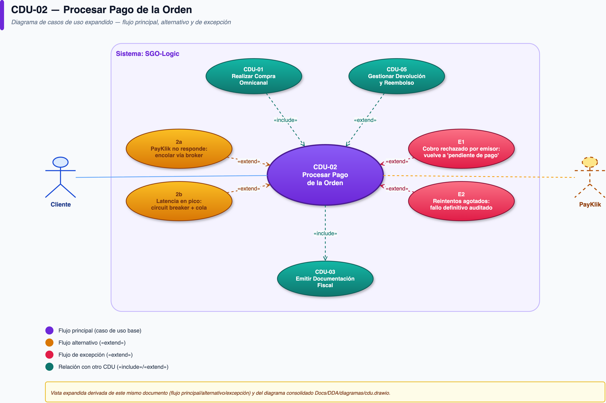

# CDU-02 — Procesar Pago de la Orden

| Campo | Detalle |
|---|---|
| **CUN de origen** | CUN-02 |
| **Actor principal** | Cliente |
| **Actores secundarios** | PayKlik (pasarela de pago, externo) |
| **Prioridad** | Crítica (driver DC-01, 20/20 — el de mayor prioridad de todo el proyecto) |
| **Disparador (trigger)** | El cliente confirma la compra en CDU-01 |

## Descripción

Registra y confirma el cobro de una orden con cualquiera de los métodos aceptados (tarjeta, transferencia, billetera digital), garantizando que la orden nunca se pierda aunque falle el proveedor de pago, y que cada intento —exitoso o no— quede auditado. Es la instancia concreta de la estrategia de resiliencia de pagos (ADR-0002).

## Diagrama de actividad

## Precondiciones

- La orden existe en estado "pendiente de pago" con inventario reservado (post-CDU-01).

## Flujo principal

1. El cliente elige método de pago (tarjeta de crédito/débito, transferencia bancaria o billetera digital).
2. El sistema envía el intento de cobro a PayKlik.
3. El sistema registra el intento (orden, canal, fecha, resultado), sea exitoso o fallido.
4. Si el cobro es exitoso, el sistema confirma la orden y dispara CDU-03 (Emitir Documentación Fiscal).

## Flujos alternativos

- **2a. PayKlik no responde o falla:** el sistema encola el intento vía el Message Broker (Transactional Outbox + Circuit Breaker, ADR-0002) y reintenta sin perder la orden; el cliente ve el estado "pago en proceso".
- **2b. Latencia de PayKlik supera el umbral aceptable en pico de demanda:** se aplica degradación controlada — el circuit breaker deja de insistir de inmediato y pasa el intento a la cola de reintentos.

## Flujos de excepción

- **E1. El cobro es rechazado por el emisor de la tarjeta (fondos insuficientes, etc.):** se registra el resultado como fallido con el motivo devuelto por PayKlik; la orden vuelve a "pendiente de pago" y el cliente puede reintentar con otro método.
- **E2. Todos los reintentos se agotan sin respuesta de PayKlik:** el intento queda marcado como fallido definitivo, auditado, y se notifica al cliente para reintentar más tarde.

## Postcondiciones

- **De éxito:** orden confirmada; historial completo y auditable de todos los intentos de cobro (orden, canal, fecha, resultado).
- **De fracaso:** orden permanece en "pendiente de pago" o "pago fallido", nunca desaparece ni se pierde.

## Reglas de negocio

- Nunca se almacena el número completo de tarjeta (PAN) ni el código CVV — solo el token/referencia que devuelve PayKlik.
- Cada intento de cobro, exitoso o fallido, debe quedar relacionado con la orden, el canal de origen, la fecha y su resultado.
- El sistema no depende exclusivamente de PayKlik para no perder la orden ante una falla del proveedor.

## Drivers relacionados

- **Calidad:** DC-01 (disponibilidad ante falla de PayKlik), DC-02 (elasticidad 8x), DC-06 (tolerancia a fallas de terceros), DC-07 (auditabilidad), DC-08 (seguridad de datos de pago)
- **Restricción:** DR-01/DR-02 (presupuesto), DR-06 (contrato PayKlik vigente)
