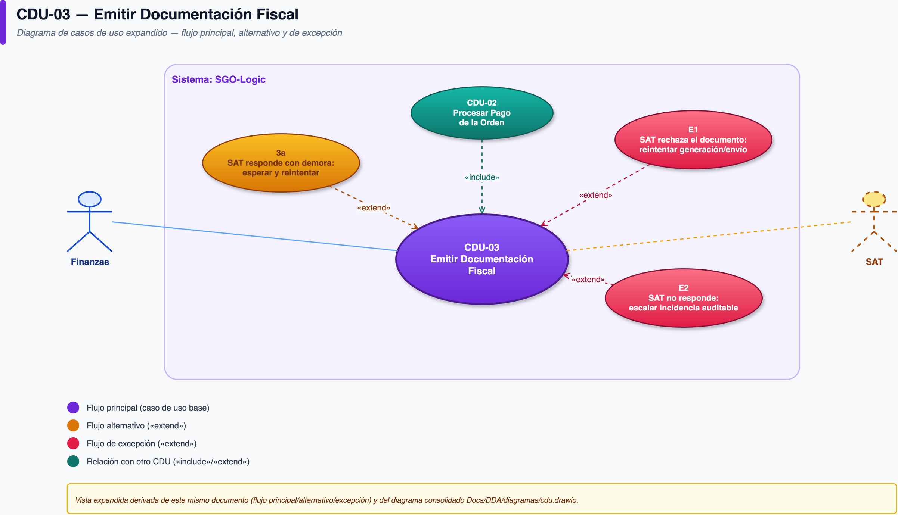

# CDU-03 — Emitir Documentación Fiscal

| Campo | Detalle |
|---|---|
| **CUN de origen** | CUN-03 |
| **Actor principal** | Sistema (automático) |
| **Actores secundarios** | SAT (facturación electrónica, externo) |
| **Prioridad** | Alta (cumplimiento regulatorio no negociable) |
| **Disparador (trigger)** | El pago de la orden se confirma exitosamente (post-CDU-02) |

## Descripción

Genera y envía la factura electrónica correspondiente a una orden confirmada, conservando el CUI y la serie autorizada exigidos por la SAT, antes de que la orden pueda continuar hacia el despacho. Ninguna orden se despacha sin respaldo fiscal.

## Diagrama de actividad

## Precondiciones

- El pago de la orden está confirmado (CDU-02 completado con éxito).

## Flujo principal

1. El sistema genera el XML de la factura con CUI y serie autorizada.
2. El sistema envía el XML a la SAT antes de finalizar la orden.
3. La SAT responde con validación/autorización del documento.
4. El sistema marca la orden como facturada y continúa hacia CDU-04 (Gestionar Despacho y Entrega).

## Flujos alternativos

- **3a. La SAT responde con demora** (tiempos de respuesta variables documentados en el caso): el sistema espera dentro de la ventana de tiempo tolerable antes de reintentar.

## Flujos de excepción

- **E1. La SAT rechaza el documento** (error de formato, serie no autorizada, etc.): el sistema reintenta la generación/envío; la orden **no** se despacha hasta que exista una factura válida — esto es una regla de negocio dura, no una preferencia técnica.
- **E2. La SAT no responde tras los reintentos configurados:** se escala como incidencia auditable para revisión manual; la orden queda retenida antes de despacho, nunca se despacha "a ciegas".

## Postcondiciones

- **De éxito:** factura electrónica emitida y vinculada a la orden; el evento queda listo para conciliarse con el ERP-Core (CDU-07).
- **De fracaso:** la orden permanece retenida antes de despacho; ninguna mercancía sale sin documento fiscal válido.

## Reglas de negocio

- Es obligatoria la emisión de la factura antes de finalizar la orden — no puede posponerse.
- Cada documento debe conservar su CUI y serie autorizada.
- Una transacción sin respaldo fiscal puede derivar en multas o inconsistencias — por eso el sistema nunca avanza a despacho sin este paso resuelto.

## Drivers relacionados

- **Calidad:** DC-04 (recuperación de evidencia < 1s), DC-07 (auditabilidad)
- **Restricción:** DR-08 (normativa SAT / protección de datos)
