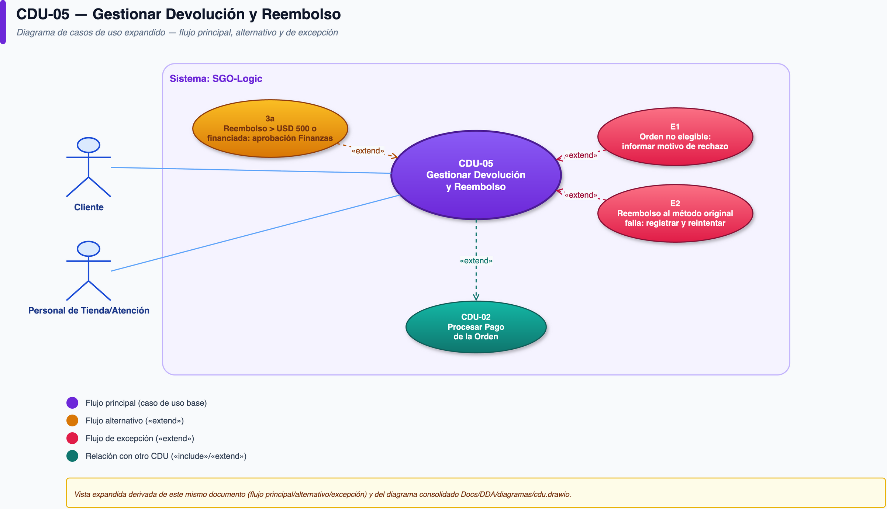

# CDU-05 — Gestionar Devolución y Reembolso

| Campo | Detalle |
|---|---|
| **CUN de origen** | CUN-05 |
| **Actor principal** | Cliente |
| **Actores secundarios** | Personal de Atención |
| **Prioridad** | Media-Alta (afecta directamente la experiencia del cliente y la trazabilidad fiscal) |
| **Disparador (trigger)** | El cliente o el personal de atención inicia una devolución/cambio sobre una orden ya entregada (o parcialmente entregada) |

## Descripción

Permite resolver una devolución o cambio referenciando la venta original, con visibilidad completa e inmediata de compra, pago, despacho y entrega — sin llamadas telefónicas ni conciliación manual, que es como se maneja hoy y por lo que tarda hasta 7 días hábiles.

## Diagrama de actividad

## Precondiciones

- Existe una orden entregada, o parcialmente entregada, asociada al cliente.

## Flujo principal

1. El cliente o el personal de atención inicia una devolución/cambio referenciando la venta original.
2. El sistema muestra la vista consolidada de compra, pago, despacho y entrega.
3. El sistema valida elegibilidad y procesa el reembolso (extiende CDU-02).
4. El sistema vincula la devolución/reembolso a la venta original de forma trazable.

## Flujos alternativos

- **3a. Reembolso mayor a USD 500, o de una venta con financiamiento activo (3/6/12 meses):** requiere aprobación de Finanzas (Directora de Finanzas o persona delegada) antes de liberarse (decisión confirmada por el equipo).

## Flujos de excepción

- **E1. La orden referenciada no es elegible para devolución** (fuera de plazo, producto no retornable, etc.): el sistema informa el motivo de rechazo al cliente/agente con la política aplicable, sin bloquear la consulta del historial.
- **E2. El reembolso hacia el método de pago original falla** (ej. PayKlik no procesa la devolución): el intento queda registrado como fallido y auditable, igual que un intento de cobro fallido en CDU-02; se reintenta sin perder la solicitud.

## Postcondiciones

- **De éxito:** devolución resuelta en máximo 2 días hábiles (meta confirmada por el equipo, frente a los 7 días actuales), con historial completo disponible para auditoría.
- **De fracaso:** la solicitud queda registrada y visible, nunca se pierde ni requiere que el cliente la reinicie desde cero.

## Reglas de negocio

- Toda devolución o reembolso debe quedar vinculado de forma trazable a la venta original.
- Montos altos o ventas financiadas exigen una aprobación adicional antes de liberar el reembolso.
- La vista consolidada elimina la necesidad de llamadas o conciliación manual entre canales para resolver el caso.

## Drivers relacionados

- **Calidad:** DC-03 (rendimiento de consulta), DC-07 (auditabilidad)
- **Restricción:** DR-08 (normativa fiscal)
