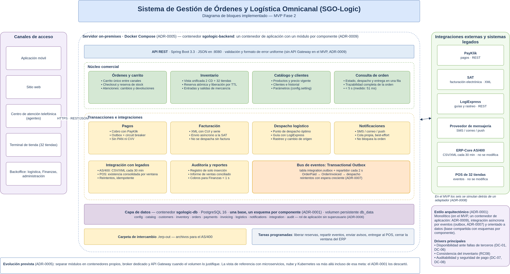
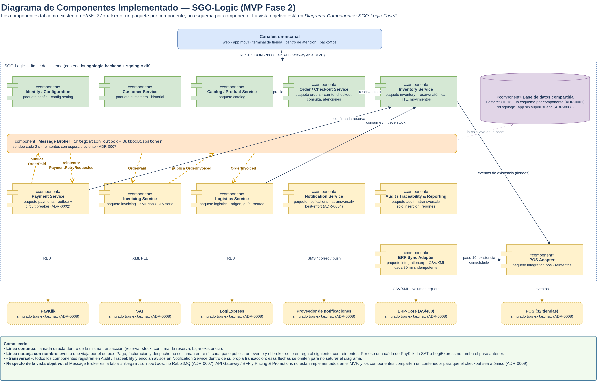
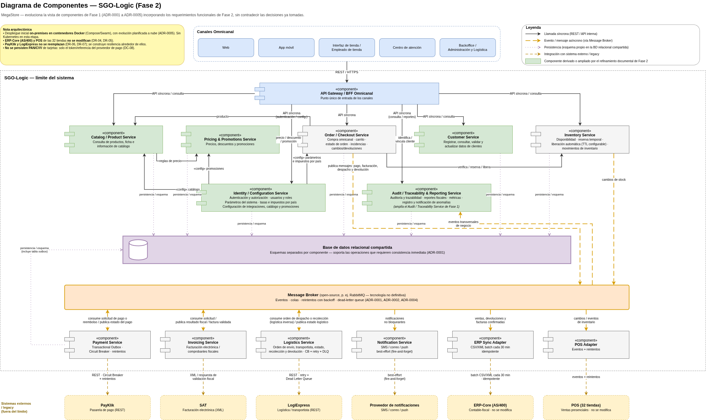

# Diagramas de bloques y de componentes — SGO-Logic (Fase 2)

Igual que el [despliegue](diagrama-de-despliegue.md), cada vista existe dos veces: la **objetivo**,
que es hacia dónde evoluciona la arquitectura, y la **implementada**, que es la que coincide con el
código del MVP. Para verificar trazabilidad contra el código hay que usar la implementada.

## Diagrama de bloques implementado

[Archivo editable](../DRAWIO/Diagrama-Bloques-Implementado-SGO-Logic-Fase2.drawio).

Los bloques del MVP: los cinco canales entran por la API REST del backend; dentro, el núcleo
comercial y el bloque de transacciones e integraciones, conectados por el bus de eventos (el
outbox); debajo, la base compartida con un esquema por componente; a la derecha, los seis
terceros, que no se modifican y en el MVP se simulan.

El [JPG de bloques de referencia](../image/Diagrama-bloques-SGO-Logic-Fase2.jpg) dibuja la meta
de evolución —microservicios, nube, Kubernetes, un balanceador, varias bases y Kafka/RabbitMQ—.
No es el estado del código —el ADR-0001 descartó microservicios completos y Kubernetes—; la tabla de correspondencia de
[diagrama-de-despliegue.md](diagrama-de-despliegue.md#correspondencia-entre-las-fuentes) explica
cada diferencia.

## Diagrama de componentes implementado

[Archivo editable](../DRAWIO/Diagrama-Componentes-Implementado-SGO-Logic-Fase2.drawio).

Muestra qué se comunica con qué y cómo:

- **Eventos por el outbox** (naranja): `OrderPaid` lleva de pagos a facturación,
  `OrderInvoiced` de facturación a logística, y `PaymentRetryRequested` devuelve a pagos un cobro
  que PayKlik no respondió. Pago, facturación y despacho no se llaman entre sí; por eso una caída
  de un tercero no tumba el paso anterior.
- **Llamadas directas** (continuas): solo donde tiene que ocurrir en la misma transacción —el
  checkout reserva stock, el cobro aprobado confirma la reserva, el despacho baja la existencia—.
- **Componentes transversales**: todos registran en auditoría y encolan avisos dentro de su
  propia transacción.

## Vista objetivo

[Archivo editable](../DRAWIO/Diagrama-Componentes-SGO-Logic-Fase2.drawio).

### Correspondencia

| Componente de la vista objetivo | En el MVP |
|---|---|
| Order / Checkout, Inventory, Catalog / Product, Customer | Implementados · paquetes `orders`, `inventory`, `catalog`, `customers` |
| Identity / Configuration | Parcial · paquete `config` lee `config.setting`; el login no está implementado |
| Payment, Invoicing, Logistics, Notification | Implementados · paquetes `payments`, `invoicing`, `logistics`, `notifications` |
| Audit / Traceability & Reporting | Implementado · paquete `audit` |
| ERP Sync Adapter, POS Adapter | Implementados · paquetes `integration.erp`, `integration.pos` |
| Message Broker (RabbitMQ) | Tabla `integration.outbox` + `OutboxDispatcher` ([ADR-0007](ADR/0007-outbox-en-la-base-como-broker-del-mvp.md)) |
| API Gateway / BFF Omnicanal | No implementado en el MVP: los canales llaman directo al backend ([ADR-0009](ADR/0009-alcance-de-despliegue-del-mvp.md)) |
| Pricing & Promotions | No implementado en el MVP: el precio sale de `catalog.product` ([ADR-0009](ADR/0009-alcance-de-despliegue-del-mvp.md)) |
| PayKlik, SAT, LogiExpress, mensajería, POS, AS/400 | Simulados detrás de los adaptadores de `external` ([ADR-0008](ADR/0008-terceros-simulados-tras-un-adaptador.md)) |
