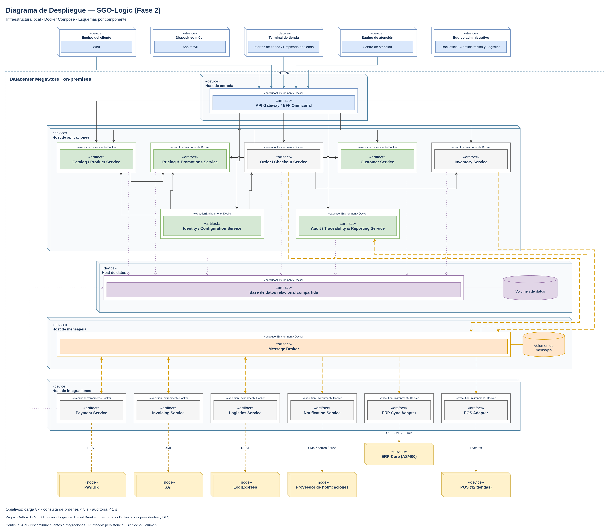
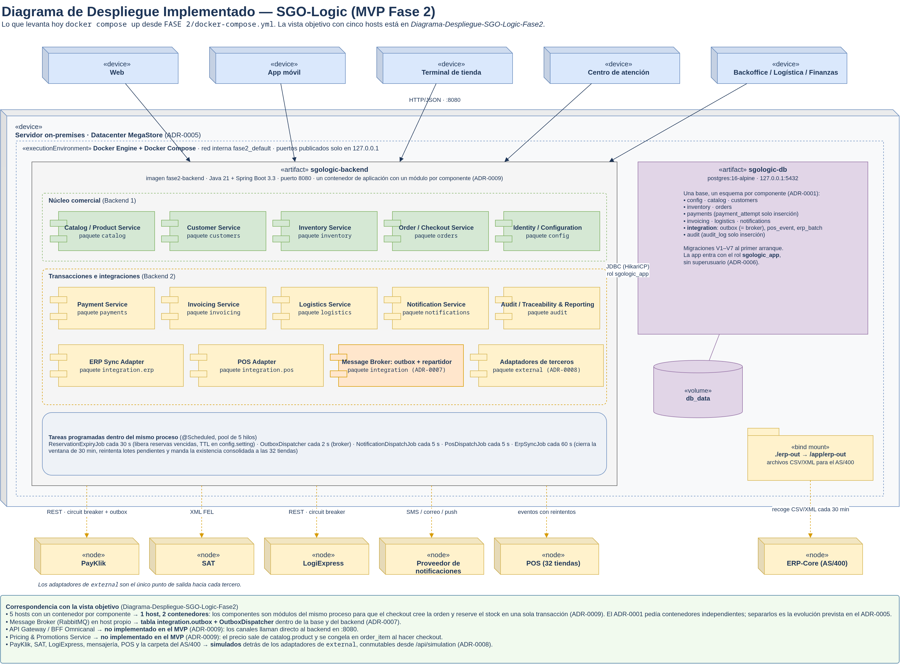

# Diagrama de despliegue — SGO-Logic (Fase 2)

> **Actualización de la Fase 3.** Esta vista implementada describe el MVP de la Fase 2, con dos contenedores y sin broker externo. Hoy el `docker-compose.yml` suma Kafka, el servicio `migrate` y los seis proveedores simulados, y en la nube corre en Render, Neon y Cloudflare R2. Las vistas actualizadas están en [FASE 3/DDA](../../FASE%203/DDA/diagramas-fase3.md) y la decisión en el [ADR-0012](../../FASE%203/DDA/ADR/0012-kafka-como-broker-con-el-outbox-como-puente.md).

[Archivo editable](../DRAWIO/Diagrama-Despliegue-SGO-Logic-Fase2.drawio).

La vista propone la ubicación de los 14 componentes de fase 2 en infraestructura local, con contenedores Docker independientes, una base relacional compartida y un broker. Los nombres de los artefactos corresponden a los componentes que implementan; no designan imágenes Docker ya construidas.

## Vista objetivo y vista implementada

Este documento tiene dos vistas y conviene no confundirlas:

- **Vista objetivo** (la de arriba): cómo se distribuirían los componentes en cinco hosts cuando
  el sistema evolucione a servicios independientes. Es la propuesta de diseño de la fase.
- **[Vista implementada](#despliegue-implementado-mvp)** (al final): lo que levanta hoy
  `docker-compose.yml`. Es la que coincide con el código fuente del MVP y la que hay que usar
  para verificar trazabilidad.

## Distribución

| Host | Artefactos desplegados |
|---|---|
| Entrada | API Gateway / BFF Omnicanal |
| Aplicaciones | Catalog / Product Service; Pricing & Promotions Service; Order / Checkout Service; Customer Service; Inventory Service; Identity / Configuration Service; Audit / Traceability & Reporting Service |
| Integraciones | Payment Service; Invoicing Service; Logistics Service; Notification Service; ERP Sync Adapter; POS Adapter |
| Datos | Base de datos relacional compartida, con esquemas por componente y volumen persistente |
| Mensajería | Message Broker, con almacenamiento persistente de mensajes |

Esta distribución en cinco hosts es una propuesta de asignación sobre la infraestructura existente, no un inventario ni un dimensionamiento comprobado. Se propone Docker Compose por host; las comunicaciones entre hosts utilizan la red local y direcciones configuradas explícitamente. Una red de Compose no se considera compartida automáticamente entre máquinas. El broker y el motor relacional permanecen sin producto ni versión definitiva, como en el diagrama de componentes.

Los equipos de cliente, tienda, atención y administración alojan los cinco canales de acceso. El AS/400 permanece dentro de la infraestructura local y fuera del software SGO-Logic; los POS permanecen en las 32 tiendas. PayKlik, SAT, LogiExpress y el proveedor de notificaciones se representan como nodos externos.

## Relaciones y notación

Los cubos representan nodos de despliegue. Dentro de cada host, los entornos de ejecución Docker contienen los artefactos de software. Las conexiones entre contenedores detallan las comunicaciones que deben habilitarse en el host o en la red local. Los volúmenes son notación complementaria para almacenamiento persistente.

Se conservan las 38 relaciones del diagrama de componentes. El enlace agregado de canales se desglosa en cinco conexiones y se añaden dos montajes de volumen: **44 conexiones en total**. La relación broker → auditoría, cuyos extremos estaban libres en el archivo de referencia, queda vinculada a ambos contenedores en esta vista.

- Líneas continuas con flecha: llamadas API; los cinco canales acceden mediante HTTPS al API Gateway/BFF.
- Líneas discontinuas: mensajería e integraciones externas. Se conserva el intercambio bidireccional del broker con pagos, facturación y logística.
- Líneas punteadas: acceso a los esquemas de la base compartida, incluido el acceso de pagos para su outbox.
- Líneas sin flecha: montaje de almacenamiento persistente. Los arcos en cruces de líneas no representan una unión.

Las integraciones mantienen REST para PayKlik y LogiExpress, XML para SAT, CSV/XML cada 30 minutos para AS/400 y eventos para POS. SMS, correo y push identifican los canales del proveedor de notificaciones, no un protocolo de transporte específico.

## Correspondencia entre las fuentes

El [JPG de bloques](../image/Diagrama-bloques-SGO-Logic-Fase2.jpg) (vista de referencia; la versión que coincide con el código es el [diagrama de bloques implementado](diagrama-de-componentes.md#diagrama-de-bloques-implementado)) presenta diferencias con el [diagrama de componentes](../DRAWIO/Diagrama-Componentes-SGO-Logic-Fase2.drawio), el [caso de acción](casoDeAccion.md) y los [drivers de fase 2](driversArquitectonicos.md). Para el despliegue inicial se aplican el enunciado y las decisiones documentadas:

| Elemento del JPG | Representación adoptada |
|---|---|
| Nube y Kubernetes | Infraestructura local con Docker Compose, según ADR-0005. La migración a nube es una evolución posterior. |
| Arquitectura de microservicios | Componentes en contenedores independientes dentro del backbone documentado en ADR-0001. |
| Varias bases de datos | Una base relacional compartida con esquemas separados. |
| Servicio de incidencias | Responsabilidad de Order / Checkout Service, conforme al diagrama de componentes. |
| Servicio de integración de legados | ERP Sync Adapter y POS Adapter separados. |
| Balanceador y herramientas de monitoreo | El acceso conserva el API Gateway/BFF; no se añaden productos, réplicas ni una plataforma de monitoreo que aún no estén definidos en los componentes. |

El JPG tampoco muestra explícitamente todos los componentes de catálogo, precios, clientes, configuración y auditoría; se mantienen los cinco en el despliegue. La nota del JPG sobre alta disponibilidad no constituye evidencia de un clúster desplegado.

## Objetivos de calidad

El diagrama muestra los objetivos de carga de 8×, consulta de órdenes en menos de 5 segundos y auditoría en menos de 1 segundo. La separación de contenedores, el broker persistente, Outbox, Circuit Breaker y reintentos dan soporte al diseño de resiliencia. La persistencia de mensajes también requiere configurar colas durables y confirmaciones; un volumen por sí solo no garantiza la entrega.

Estas son metas de diseño, pendientes de dimensionamiento y pruebas de carga y recuperación. Los cinco hosts no implican réplicas ni failover: la disponibilidad de la infraestructura local y los respaldos necesitan concretarse al implementar. Se mantiene el presupuesto documentado como restricción, sin afirmar un costo operativo calculado.

## Despliegue implementado (MVP)

[Archivo editable](../DRAWIO/Diagrama-Despliegue-Implementado-SGO-Logic-Fase2.drawio).

El MVP corre en **un host con dos contenedores**, definidos en `FASE 2/docker-compose.yml`:

| Contenedor | Imagen | Qué lleva | Persistencia |
|---|---|---|---|
| `sgologic-backend` | `fase2-backend` (Java 21, Spring Boot 3.3) | Los componentes del diagrama, uno por paquete, más las tareas programadas | Bind mount `./erp-out` → `/app/erp-out` para los archivos del AS/400 |
| `sgologic-db` | `postgres:16-alpine` | Una base, un esquema por componente; `integration.outbox` hace de broker | Volumen `db_data` |

Ambos publican su puerto solo en `127.0.0.1`. El backend entra a la base con el rol
`sgologic_app`, sin privilegios de superusuario (ADR-0006).

### De componente a código

Cada artefacto de la vista objetivo tiene su lugar concreto en la implementada:

| Componente (vista objetivo) | Dónde vive en el MVP | Esquema de datos |
|---|---|---|
| Catalog / Product Service | `sgologic-backend` · paquete `catalog` | `catalog` |
| Customer Service | `sgologic-backend` · paquete `customers` | `customers` |
| Inventory Service | `sgologic-backend` · paquete `inventory` (incluye `ReservationExpiryJob`) | `inventory` |
| Order / Checkout Service | `sgologic-backend` · paquete `orders` | `orders` |
| Identity / Configuration Service | `sgologic-backend` · paquetes `auth` (login con JWT) y `config` (lectura de `config.setting`) | `config` |
| Payment Service | `sgologic-backend` · paquete `payments` | `payments` |
| Invoicing Service | `sgologic-backend` · paquete `invoicing` | `invoicing` |
| Logistics Service | `sgologic-backend` · paquete `logistics` | `logistics` |
| Notification Service | `sgologic-backend` · paquete `notifications` | `notifications` |
| Audit / Traceability & Reporting Service | `sgologic-backend` · paquete `audit` | `audit` |
| ERP Sync Adapter | `sgologic-backend` · paquete `integration.erp` | `integration.erp_batch*` |
| POS Adapter | `sgologic-backend` · paquete `integration.pos` | `integration.pos_event` |
| Message Broker | `sgologic-db` · tabla `integration.outbox` + `OutboxDispatcher` en el backend (ADR-0007) | `integration.outbox` |
| Adaptadores hacia PayKlik, SAT, LogiExpress, mensajería, POS y AS/400 | `sgologic-backend` · paquete `external`, simulados (ADR-0008) | — |
| API Gateway / BFF Omnicanal | **No implementado en el MVP** ([ADR-0009](ADR/0009-alcance-de-despliegue-del-mvp.md)). Los canales llaman directo al backend en `:8080` | — |
| Pricing & Promotions Service | **No implementado en el MVP** ([ADR-0009](ADR/0009-alcance-de-despliegue-del-mvp.md)). El precio sale de `catalog.product` y se congela en `order_item` | — |

### Por qué difiere de la vista objetivo

- **Un contenedor de aplicación en lugar de uno por componente.** El ADR-0001 y el ADR-0005 piden
  contenedores independientes, pero el mismo ADR-0001 pide llamadas *in-process* para lo que exige
  consistencia inmediata, y el checkout necesita crear la orden y reservar el stock en una sola
  transacción. El MVP junta los componentes en un proceso, con un paquete y un esquema por
  componente y los pasos que dependen de un tercero conectados por eventos del outbox. La decisión
  y sus costos están en el [ADR-0009](ADR/0009-alcance-de-despliegue-del-mvp.md); separarlos
  sigue siendo la evolución prevista del ADR-0005.
- **Sin RabbitMQ.** El outbox en la base cumple la garantía que pedía el ADR-0002 (el evento y el
  cambio de estado se guardan juntos) sin agregar un componente con estado propio. La decisión y
  su límite están en el [ADR-0007](ADR/0007-outbox-en-la-base-como-broker-del-mvp.md).
- **Terceros simulados.** No existen proveedores reales contra los cuales integrarse; cada uno
  está detrás de su adaptador, que es el único archivo que cambia el día que existan
  ([ADR-0008](ADR/0008-terceros-simulados-tras-un-adaptador.md)).

## Referencias

- [Enunciado, apartados 4.2 y 4.4](<../../FASE 1/Docs/Enunciado/Proyecto Fase 1.pdf>).
- [ADR-0001: componentes, broker y base compartida](<../../FASE 1/Docs/ADR/0001-estilo-arquitectonico-monolito-modular-con-broker.md>).
- [ADR-0002: resiliencia de pagos](<../../FASE 1/Docs/ADR/0002-resiliencia-pagos-payklik.md>).
- [ADR-0003: integración con ERP-Core](<../../FASE 1/Docs/ADR/0003-integracion-batch-erp-core.md>).
- [ADR-0004: tolerancia a fallas de terceros](<../../FASE 1/Docs/ADR/0004-tolerancia-fallas-terceros.md>).
- [ADR-0005: despliegue local y evolución a nube](<../../FASE 1/Docs/ADR/0005-despliegue-on-premises-evolucion-nube.md>).
- [Vista de despliegue de fase 1](<../../FASE 1/Docs/Diagramas/despliegue.drawio>).
