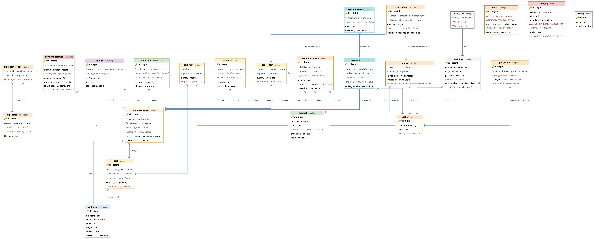

# Base de datos



[Fuente editable](Diagrama-Entidad-Relacion-SGO-Logic-Fase2.dot). Muestra las 24 tablas de datos, con sus columnas, sus llaves y las líneas reales de relación entre ellas. Las 17 tablas de referencia no se dibujan aparte: se anotan en gris junto a la llave foránea que las usa (por ejemplo `· category_id → product_category` dentro de `product`); sus valores están en la sección "Tablas de referencia" de este documento.

Está hecho con [Graphviz](https://graphviz.org/) en vez de drawio, porque el layout (dónde va cada tabla y por dónde pasa cada línea) lo calcula la herramienta, no a mano. Para regenerarlo después de cambiar el modelo:

```
dot -Tpng -Gdpi=150 db/Diagrama-Entidad-Relacion-SGO-Logic-Fase2.dot -o image/Diagrama-Entidad-Relacion-SGO-Logic-Fase2.png
```

Se instala con `brew install graphviz`. El archivo `.dot` se edita a mano (es texto plano); no hay una app gráfica para este formato como sí la hay para drawio.

PostgreSQL 16 con una sola base, `sgologic`, y un esquema por componente, como se decidió en el ADR-0001. La base es compartida, pero cada componente escribe solo en su esquema.

## Cómo levantarla

Desde la carpeta `FASE 2`:

```
docker compose up -d db
```

La primera vez, Postgres ejecuta los archivos de `db/migrations` en orden. Los datos quedan en un volumen, así que al reiniciar no se pierde nada.

El puerto solo se publica en `127.0.0.1`, así que la base no queda visible para el resto de la red.

Hay dos usuarios. `sgologic` es el dueño de la base: lo usan las migraciones y quien administra. El backend y cualquier herramienta que solo use la base (DBeaver incluido) deben conectarse con `sgologic_app`, que no puede cambiar la estructura ni saltarse las reglas de la sección de abajo.

| Usuario | Clave por defecto | Variable para cambiarla | Uso |
|---|---|---|---|
| `sgologic` | `sgologic_dev` | `DB_PASSWORD` | Migraciones, administración |
| `sgologic_app` | `sgologic_app_dev` | `DB_APP_PASSWORD` | Backend, consultas del día a día |

Estas claves son solo para desarrollo local. En cualquier entorno real hay que cambiarlas.

## Qué guarda cada esquema

| Esquema | Tablas |
|---|---|
| `config` | `setting`, y los canales de venta y el estado de envío que comparten varios componentes |
| `catalog` | `product`, `product_category` |
| `customers` | `customer` |
| `inventory` | `location`, `stock`, `stock_movement`, `reservation` |
| `orders` | `cart`, `cart_item`, `purchase_order`, `order_item`, `incident` |
| `payments` | `payment_attempt` |
| `invoicing` | `invoice` |
| `logistics` | `shipment`, `tracking_event`, `carrier` |
| `notifications` | `notification` |
| `integration` | `outbox`, `pos_event`, `erp_batch`, `erp_batch_order` |
| `audit` | `audit_log` |

`config` también tiene `app_user`, `user_role` y `role`: son el personal que usa el sistema (administradores, empleados de tienda, logística, Finanzas), no los clientes finales. Los clientes son datos de negocio y viven en `customers.customer`.

Además hay tablas de referencia, que se explican abajo, y 3 vistas de lectura.

## Consultar sin escribir el esquema

La base trae configurado el `search_path` con todos los esquemas, y los nombres de tabla son únicos en toda la base. Por eso `select * from purchase_order` funciona igual que `select * from orders.purchase_order`, y el backend y el ORM no necesitan configurar un esquema por entidad. Si alguna herramienta ignora esa configuración, se usa el nombre completo.

## Tablas de referencia

Todo dato con un conjunto fijo de valores, como un canal o un estado, vive en su propia tabla con `id`, `code` y `name`. Las tablas de datos guardan solo el `id`. Por ejemplo, `orders.purchase_order.status_id` apunta a `orders.order_status`.

Cada tabla de referencia está en el esquema del componente que la usa. Las que usan varios componentes están en `config`. Los ids son fijos y siguen el orden en que aparecen abajo: en `config.channel`, `WEB` es 1, `MOBILE` es 2 y `CALL_CENTER` es 3.

| Tabla | Valores |
|---|---|
| `config.channel` | WEB, MOBILE, CALL_CENTER |
| `config.delivery_status` | PENDING, DELIVERED, FAILED |
| `catalog.product_category` | LINEA_BLANCA, ELECTRONICA, ROPA, CALZADO |
| `inventory.location_type` | DISTRIBUTION_CENTER, STORE |
| `inventory.movement_type` | IN, OUT |
| `inventory.reservation_status` | ACTIVE, CONFIRMED, RELEASED, EXPIRED |
| `orders.cart_status` | OPEN, IN_CHECKOUT, CONVERTED, ABANDONED |
| `orders.order_status` | PENDING_PAYMENT, PAYMENT_IN_PROGRESS, PAYMENT_FAILED, PAID, INVOICED, IN_DISPATCH, DELIVERED, CANCELLED, RETURNED |
| `orders.incident_type` | EXCHANGE, RETURN |
| `orders.incident_status` | REGISTERED, IN_PROCESS, RESOLVED, REJECTED |
| `payments.payment_result` | APPROVED, DECLINED, TIMEOUT, ERROR |
| `invoicing.invoice_status` | GENERATED, SENT, ACCEPTED, REJECTED |
| `logistics.carrier` | LOGIEXPRESS |
| `logistics.shipment_status` | ASSIGNED, GUIDE_REQUESTED, GUIDE_ISSUED, IN_TRANSIT, DELIVERED, FAILED |
| `notifications.notification_channel` | SMS, EMAIL, PUSH |
| `integration.file_format` | CSV, XML |
| `config.role` | ADMIN, STORE_EMPLOYEE, STORE_MANAGER, CALL_CENTER_AGENT, LOGISTICS, FINANCE |

`config.delivery_status` la comparte todo lo que se envía con reintentos: `outbox`, `notification`, `pos_event` y `erp_batch`. `FAILED` significa que se agotaron los reintentos, y en un lote del ERP `PENDING` significa generado pero aún no enviado.

Para obtener un id desde el código, por ejemplo el de una orden pagada:

```sql
select id from orders.order_status where code = 'PAID';
```

Si hace falta un valor nuevo, se agrega con un `INSERT` en una migración nueva. Los ids que ya existen no se cambian.

## Vistas de lectura

Como las tablas guardan ids, hay tres vistas que devuelven los códigos ya resueltos:

- `orders.order_overview`: el estado completo de una orden en una fila, con su último cobro, su factura y su envío. Es la consulta de menos de 5 segundos.
- `payments.payment_audit`: cada intento de cobro con el canal de su orden. Es lo que consulta Finanzas.
- `integration.erp_batch_summary`: cada lote del ERP con la cantidad de órdenes y el monto, calculados a partir de sus órdenes.

## Reglas que hace cumplir la base

- No se puede reservar más stock del que hay (`reserved <= on_hand`), aunque falle la lógica de la aplicación.
- `audit.audit_log` y `payments.payment_attempt` solo aceptan inserciones. Un `UPDATE`, `DELETE` o `TRUNCATE` da error, incluso conectado como `sgologic`.
- No existe ninguna columna para el número de tarjeta ni para el CVV. De la tarjeta solo se guarda la referencia de PayKlik y los últimos 4 dígitos.
- La base rechaza un número que parezca de tarjeta si se cuela en un texto libre o en un `jsonb` (ver la sección de seguridad).
- Las contraseñas de `config.app_user` tienen que venir ya cifradas por el backend; la base rechaza una que parezca texto plano.
- Una orden entra en un solo lote del ERP, así no se manda la misma venta dos veces.
- Un cliente solo puede tener un carrito activo, sin importar el canal.
- Solo se puede reservar un producto que la orden realmente lleva.
- El POS solo recibe eventos de tiendas, nunca de un centro de distribución.

## Seguridad

**El backend nunca se conecta como `sgologic`.** Ese usuario es dueño de las tablas y puede alterar cualquier cosa, incluida la estructura. `sgologic_app` no es dueño de nada: solo tiene los permisos que necesita para operar, tabla por tabla, y eso es lo que de verdad evita que una conexión de la aplicación desactive el trigger de auditoría, agregue una columna o borre una tabla. Lo comprobé a propósito: con `sgologic_app` conectado, intentar `ALTER TABLE ... DISABLE TRIGGER` o `ALTER TABLE ... ADD COLUMN` sobre `audit_log` o `payment_attempt` da "must be owner of table".

Por tabla, `sgologic_app` tiene:

- Solo lectura en las 17 tablas de referencia: se cargan y cambian por migración, nunca desde la aplicación.
- Insertar y nada más en `payments.payment_attempt` y `audit.audit_log`. Ni siquiera tiene el permiso de `UPDATE` o `DELETE`, así que la regla de solo-inserción no depende únicamente del trigger.
- Insertar, actualizar y a veces borrar en las tablas donde el negocio lo necesita (el carrito, por ejemplo, se borra; una orden ya creada no).

El detalle completo está en `V5__rol_de_aplicacion.sql`, y el porqué en [ADR-0006](../DDA/ADR/0006-rol-de-aplicacion-sin-privilegios-de-superusuario.md). Si se agrega una tabla en una migración nueva, hay que agregar también su permiso ahí; si no, `sgologic_app` solo podrá leerla.

**Números de tarjeta fuera de las columnas de pago.** No tener una columna para el PAN no alcanza: un número podría colarse en el motivo de rechazo de un cobro, en el detalle de una incidencia o en el payload de un evento. `audit.has_card_number()` busca de 13 a 19 dígitos, juntos o separados por espacio o guion, que además pasen la verificación de Luhn (el dígito de control que usan las tarjetas reales), y una restricción la aplica en `payment_attempt`, `audit_log`, `outbox`, `pos_event`, `notification`, `invoice`, `incident`, `stock_movement` y `tracking_event`. Pedir que pase Luhn reduce que una referencia interna larga se marque por error, aunque no lo elimina del todo: una referencia de PayKlik que por casualidad pase Luhn se rechazaría igual, y ahí toca ajustar el formato de esa referencia, no la regla.

**Identidad, sin usuarios de ejemplo.** `config.app_user` guarda el hash de la contraseña, nunca la contraseña; una restricción rechaza un valor que no tenga la forma de un hash de bcrypt, argon2, pbkdf2 o scrypt. También lleva el conteo de intentos fallidos y un bloqueo temporal (`locked_until`), para que el backend pueda implementar el bloqueo por intentos sin inventar esa lógica en otro lado. No se cargan usuarios de prueba a propósito: crearlos y fijarles una contraseña le toca al backend cuando exista el login.

**Lo que sigue sin resolver en la base**, porque le corresponde a otra capa: cifrar la conexión con TLS (se decide al desplegar, no en el esquema) y que las claves de producción no sean las de este README (hoy son para desarrollo local).

## Normalización

La estructura está en tercera forma normal: cada dato vive en un solo lugar y las demás tablas lo consultan por su llave. Por eso los canales, los estados y los tipos tienen su propia tabla, el carrito no guarda precios (salen del catálogo hasta que se crea la orden), el intento de cobro no repite el canal (se toma de la orden) y la cantidad y el monto de cada lote del ERP se calculan en una vista en lugar de guardarse.

Hay copias que se dejaron a propósito:

- `inventory.stock` guarda `on_hand` y `reserved` como contadores, para reservar de forma atómica sin recorrer todos los movimientos. Los movimientos y las reservas siguen ahí para poder cuadrarlos.
- `orders.purchase_order` guarda `total` y `delivery_address` tal como se acordaron al comprar. Si después cambia el precio o la dirección del cliente, la orden no cambia. Por lo mismo `orders.order_item` guarda el `unit_price` del momento y `notifications.notification` guarda el destinatario al que se mandó el aviso.
- `audit.audit_log` repite el canal y no tiene llave foránea a la orden, para no depender de otras tablas y consultarse en menos de 1 segundo.

Quedan como texto libre, a propósito, los valores que no son un conjunto fijo: `action` y `entity_type` de la auditoría, y `event_type` y `aggregate_type` del outbox, que son los nombres de los mensajes entre componentes y crecen con el código. También los textos que vienen de afuera, como el motivo de rechazo de un cobro.

## Datos de prueba

`V2__datos_de_prueba.sql` carga 2 centros de distribución, 32 tiendas, 12 productos con su stock, 100 clientes y los tres valores de `config.setting`. Son datos de ejemplo. El tiempo de reserva de 15 minutos es un valor por defecto que se puede cambiar.

## Cargar órdenes de prueba

Las migraciones dejan el catálogo, el stock y los clientes, pero ninguna orden. Con la base levantada, este script agrega órdenes y todo lo que las rodea: reservas, cobros, facturas, envíos, notificaciones, outbox, eventos del POS, lotes del ERP y auditoría.

```
./db/scripts/cargar-datos-de-prueba.sh          # 200 órdenes
./db/scripts/cargar-datos-de-prueba.sh 5000     # la cantidad que quieras
```

Las órdenes salen en todos los estados, desde pendientes de pago hasta devueltas, y con las fallas que el sistema tiene que tolerar: cobros de PayKlik con timeout y su reintento en el outbox, guías de LogiExpress sin número, mensajes que no salieron y eventos del POS sin entregar. Además hay clientes con un carrito abierto.

El stock sigue cuadrando con los movimientos. Si una tienda no tiene unidades para tantas ventas, el script registra una reposición antes de venderlas.

Cada corrida suma datos, no borra los anteriores. Con 20 000 órdenes tarda unos 19 segundos.

## Empezar de cero

La auditoría y los cobros no se pueden borrar, así que para limpiar la base hay que crearla de nuevo. Este script borra todo, levanta la base otra vez desde las migraciones y espera a que esté lista:

```
./db/scripts/reiniciar-base.sh          # pregunta antes de borrar
./db/scripts/reiniciar-base.sh -y       # sin preguntar
./db/scripts/reiniciar-base.sh -y 500   # sin preguntar y con 500 órdenes de prueba
```

## Cuando el backend use Flyway

Los archivos `.sql` ya siguen el nombre que Flyway espera (`V1__...`). Ese día hay que quitar el montaje de `docker-entrypoint-initdb.d` del compose para que las migraciones no corran dos veces.

`V6__contrasena_de_la_app.sh` es la excepción: es un script de shell, y Flyway no ejecuta `.sh` como migración. Ese paso —fijar la contraseña real de `sgologic_app` desde una variable de entorno— hay que resolverlo aparte (una migración con callback, o un paso del despliegue), no simplemente renombrándolo a `.sql`.
