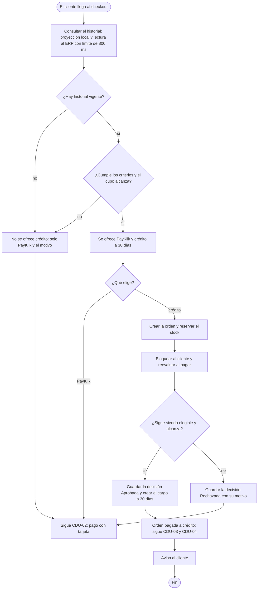

# CDU-09 — Comprar a crédito

| Campo | Detalle |
|---|---|
| **Actor principal** | Cliente |
| **Actores secundarios** | ERP (historial del cliente), PayKlik (ruta alterna de pago), Finanzas (define los criterios) |
| **Prioridad** | Alta: es la regla de negocio que agrega la Fase 3 |
| **Disparador (trigger)** | El cliente llega al checkout con productos en su carrito |

## Descripción

Decide cómo puede pagar el cliente antes de que pague: PayKlik siempre, y el crédito propio «Compra ahora, paga en 30 días» solo cuando su historial de compras, devoluciones, incidencias y pagos lo permite. La decisión se toma en el checkout, sin que nadie revise a mano, y la orden termina confirmada o rechazada por la ruta elegida sin quedar nunca esperando una respuesta. Se apoya en CDU-02 (pago) y dispara CDU-03 y CDU-04 cuando la orden se aprueba.

## Diagrama de actividad

## Precondiciones

- El cliente tiene sesión iniciada y un carrito con productos disponibles.
- Los criterios del crédito están configurados (`credit.*` en la configuración del sistema).

## Flujo principal

1. El cliente abre el checkout.
2. El sistema obtiene el historial del cliente: usa la proyección local del ERP y la refresca si hace falta, con un límite de 800 ms. Lo suma al historial interno de órdenes, devoluciones, incidencias y pagos.
3. El sistema evalúa los criterios: compras entregadas mínimas, importe mínimo, y cero incidencias confirmadas, devoluciones, pagos atrasados y pagos rechazados. Verifica además que no haya saldo vencido ni una solicitud de cambio o devolución en revisión, y que el total quepa en el cupo disponible.
4. El checkout muestra PayKlik y, si el cliente es elegible, «Crédito MegaStore · paga en 30 días» con su cupo disponible.
5. El cliente elige crédito y confirma la compra. El sistema crea la orden y reserva el stock.
6. El cliente confirma el pago. El sistema bloquea al cliente para serializar su gasto de crédito, reevalúa y, si todo se cumple, guarda la decisión **Aprobada** con el detalle de la evaluación y crea un cargo a 30 días.
7. La orden queda pagada a crédito y dispara la factura y el envío (CDU-03 y CDU-04).
8. El sistema notifica al cliente la decisión.

## Flujos alternativos

- **2a. El ERP no responde y no hay historial vigente:** la opción de crédito no aparece y el cliente sigue con PayKlik. La venta no espera al ERP.
- **3a. El cliente no cumple los criterios:** el checkout muestra solo PayKlik y el motivo, por ejemplo «Se requieren más compras entregadas». El cliente sigue por CDU-02.
- **6a. El riesgo cambió entre el checkout y el pago:** si el cliente dejó de ser elegible, por ejemplo por una devolución nueva, el sistema guarda la decisión **Rechazada** con su motivo y la misma orden puede pagarse con PayKlik.

## Flujos de excepción

- **E1. El crédito disponible no cubre el total:** se rechaza con el motivo «crédito disponible insuficiente»; el cliente puede pagar con PayKlik.
- **E2. Dos compras a crédito simultáneas del mismo cliente:** el candado las serializa. La segunda se evalúa con el cupo ya usado por la primera, así que no puede superar el límite.

## Postcondiciones

- **De éxito:** orden pagada a crédito, cargo con vencimiento a 30 días, decisión guardada y auditada, y aviso enviado.
- **De fracaso:** decisión **Rechazada** guardada con su motivo y orden pendiente de pago, que puede pagarse con PayKlik. Nunca queda una orden congelada.

## Reglas de negocio

- Toda solicitud, aprobada o rechazada, queda registrada con el detalle de la evaluación, para que Finanzas pueda justificarla.
- Los criterios, el límite y el plazo los cambia el administrador sin desplegar; aplican a la siguiente compra.
- La ruta de PayKlik no depende del crédito, ni al revés.
- Nunca se almacena el número de tarjeta.

## Drivers relacionados

- **Funcionales:** RN-C01 a RN-C04
- **Calidad:** CC-01 (decisión rápida), CC-02 (ERP caído), CC-03 (compras simultáneas), CC-04 (trazabilidad)
- **Decisión:** [ADR-0010](../ADR/0010-evaluacion-de-credito-propio.md)
- **Flujo demostrable:** [HP-04](../../FLUJOS/HP-04-compra-a-credito.md)
