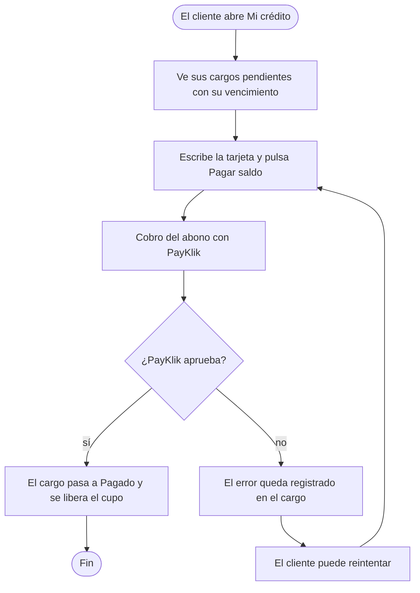

# CDU-10 — Abonar el saldo de un crédito

| Campo | Detalle |
|---|---|
| **Actor principal** | Cliente |
| **Actores secundarios** | PayKlik (cobro del abono) |
| **Prioridad** | Alta: cierra el ciclo del crédito y libera el cupo |
| **Disparador (trigger)** | El cliente tiene un cargo de crédito pendiente y decide pagarlo |

## Descripción

El cliente paga con tarjeta un cargo que quedó pendiente de una compra a crédito (CDU-09). El abono confirmado libera el cupo, y si falla queda registrado para reintentarlo, sin dejar al cliente con un saldo en un estado dudoso.

## Diagrama de actividad

## Precondiciones

- El cliente tiene sesión iniciada y al menos un cargo de crédito sin pagar.

## Flujo principal

1. El cliente abre «Mi crédito» y ve sus cargos pendientes con su fecha de vencimiento.
2. Escribe el número de tarjeta y el CVV, y pulsa «Pagar saldo».
3. El sistema cobra el abono con PayKlik.
4. Con el cobro aprobado, el cargo pasa a «Pagado» y el cupo disponible vuelve a subir.
5. La pantalla confirma «Abono registrado.»

## Flujos alternativos

- **3a. PayKlik no responde:** el abono se reintenta por la cola, con espera creciente, sin perderse.
- **1a. El cargo ya venció:** sigue pudiéndose abonar, pero cuenta como pago fuera de plazo en la evaluación de compras futuras.

## Flujos de excepción

- **E1. El abono falla:** el error queda registrado en el cargo y el cliente puede reintentarlo.
- **E2. Hay una devolución de una orden con cargo sin abonar:** el reembolso espera la confirmación del abono y se retoma solo.

## Postcondiciones

- **De éxito:** cargo «Pagado», cupo liberado y abono auditado.
- **De fracaso:** cargo pendiente con el motivo del error, sin cambiar el cupo.

## Reglas de negocio

- Nunca se almacena el número de tarjeta; solo se usan sus últimos cuatro dígitos para procesar el cobro.
- Un cargo vencido sin pagar bloquea el crédito del cliente para compras nuevas.

## Drivers relacionados

- **Funcionales:** RN-C05
- **Calidad:** CC-02 y CC-04
- **Decisión:** [ADR-0010](../ADR/0010-evaluacion-de-credito-propio.md) y [ADR-0012](../ADR/0012-kafka-como-broker-con-el-outbox-como-puente.md)
- **Flujo demostrable:** [HP-04](../../FLUJOS/HP-04-compra-a-credito.md)
