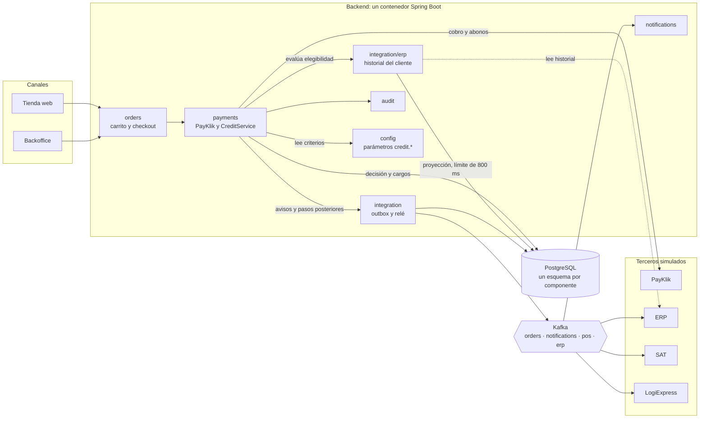
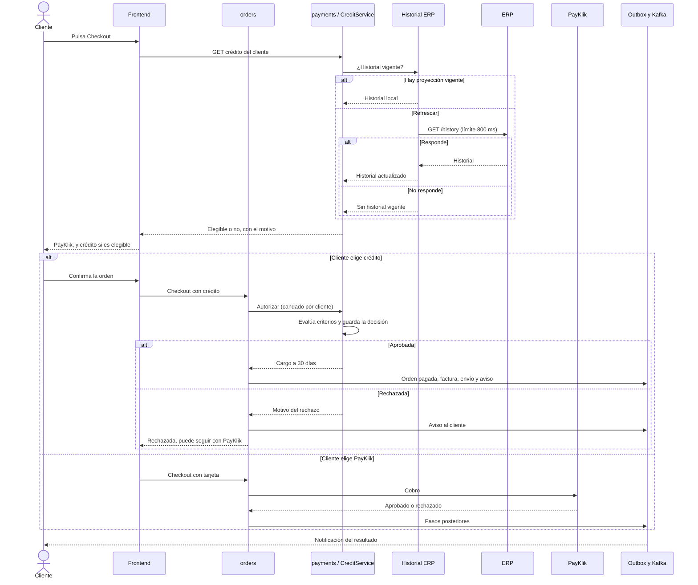
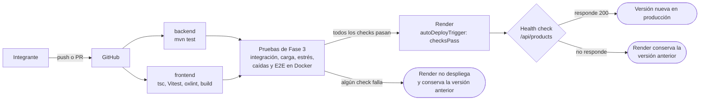
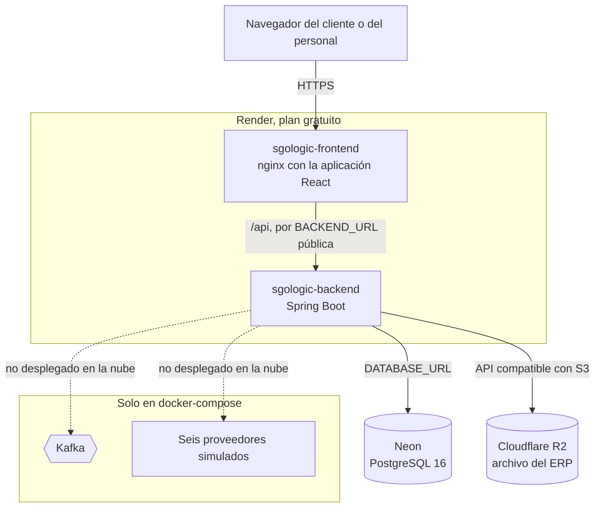

# Diagramas de la Fase 3

Vistas de lo que la Fase 3 agregó: el crédito propio en el checkout, el pipeline de CI/CD y el despliegue en la nube. Están en Mermaid para que se lean directo en GitHub y se editen como texto. Las vistas de las fases anteriores siguen en [FASE 2/DDA](../../FASE%202/DDA/).

## Componentes: el crédito dentro del monolito

El crédito no es un módulo aislado. Vive en el componente de pagos, usa el historial del ERP a través de una proyección local y se comunica con el resto por el outbox, como pide la extensión disciplinada de la arquitectura ([ADR-0010](ADR/0010-evaluacion-de-credito-propio.md)).

## Secuencia: checkout con decisión de crédito

El cliente nunca queda esperando: si el crédito no está disponible, la ruta de PayKlik sigue abierta.

## Pipeline de CI/CD

Render despliega solo si los checks pasan ([ADR-0011](ADR/0011-cicd-y-despliegue-en-la-nube.md)).

## Despliegue en la nube

Vista parcial: Kafka y los proveedores solo existen en docker-compose ([ADR-0011](ADR/0011-cicd-y-despliegue-en-la-nube.md)).

