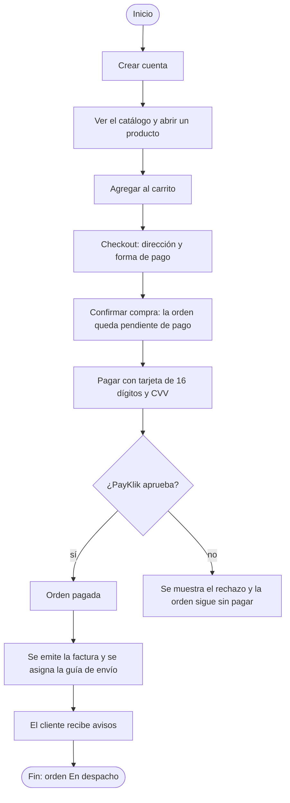
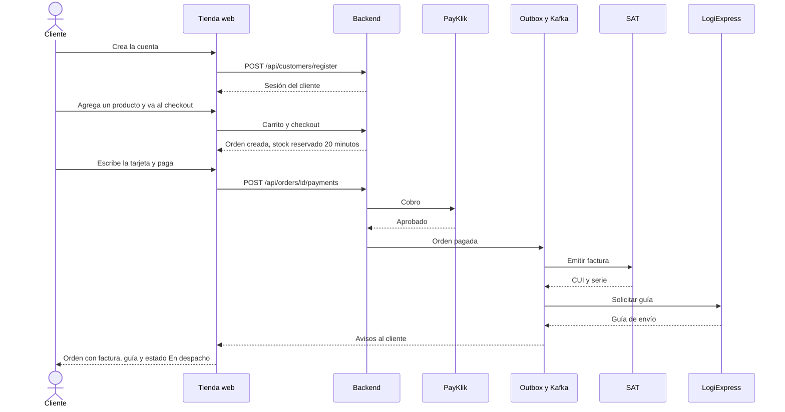

# HP-01: compra con tarjeta

Un cliente nuevo crea su cuenta, elige un producto, lo paga con tarjeta y sigue su orden hasta tener la factura y la guía de envío.

**Quién:** cliente. **Tiempo:** unos 5 minutos. **Dónde:** local con Docker (en la nube el pago no funciona completo).

## Antes de empezar

- El sistema levantado, con la tienda en `http://localhost:8081`.
- Ningún dato más: el cliente se crea en el recorrido.

## Diagrama del flujo

## Diagrama de secuencia

## Pasos

| Paso | Qué haces | Resultado esperado | Captura |
|---|---|---|---|
| 1 | En `/ingresar`, pulsa «¿No tienes cuenta? Crear una» y completa nombre, correo y contraseña. Pulsa «Crear cuenta» | Entras al catálogo con la sesión iniciada. Arriba aparece tu nombre | [Crear cuenta](capturas/hp01-01-crear-cuenta.png) |
| 2 | Mira el catálogo | Los 12 productos con su precio y «Disponible» | [Catálogo](capturas/hp01-02-catalogo.png) |
| 3 | Abre «Estufa de 4 quemadores» y pulsa «Agregar al carrito» | Aviso de que se agregó. El carrito de arriba muestra (1) | [Detalle del producto](capturas/hp01-03-detalle-producto.png) |
| 4 | Abre «Carrito» | La estufa, cantidad 1, total Q 2,100.00 | [Carrito](capturas/hp01-04-carrito.png) |
| 5 | Pulsa «Continuar» y escribe la dirección de entrega | En «Cómo pagarás» solo aparece PayKlik: el cliente es nuevo y no tiene crédito | [Checkout](capturas/hp01-05-checkout.png) |
| 6 | Pulsa «Confirmar compra» | La orden queda creada y pendiente de pago, con «Pagar ahora» y «Cancelar orden» | [Orden pendiente](capturas/hp01-06-orden-pendiente-de-pago.png) |
| 7 | Pulsa «Pagar ahora», elige «Tarjeta de crédito/débito», escribe `4242 4242 4242 4242` y cualquier CVV, y pulsa «Pagar Q 2100.00» | La pantalla de pago acepta el número y avanza | [Pago con tarjeta](capturas/hp01-07-pago-con-tarjeta.png) |
| 8 | Espera unos segundos en el detalle de la orden | Estado «En despacho». Los pasos Cobro, Pagado y Factura en verde. Aparecen la guía `LOGIEXPRESS-…` y la factura con su CUI, serie A y fecha | [Orden pagada](capturas/hp01-08-orden-pagada.png) |
| 9 | Abre «Mis órdenes» | La orden en la lista, con su estado | [Mis órdenes](capturas/hp01-09-mis-ordenes.png) |
| 10 | Abre «Notificaciones» | Los avisos de la compra | [Notificaciones](capturas/hp01-10-notificaciones.png) |

## Qué pasa por dentro

La orden y su cobro se confirman al instante. La factura y la guía no: se encolan en el outbox y viajan por Kafka hasta la SAT y LogiExpress, por eso tardan unos segundos en aparecer. Si un proveedor falla, la compra no se deshace y el trabajo se reintenta.

## Qué revisar

- [ ] La cuenta se crea y queda la sesión iniciada.
- [ ] En el checkout de un cliente nuevo solo aparece PayKlik.
- [ ] La orden termina «En despacho» con factura (CUI, serie A) y guía `LOGIEXPRESS-…`.
- [ ] «Mis órdenes» y «Notificaciones» muestran la compra.
- [ ] El número de tarjeta no se guarda en ninguna pantalla posterior.

## Variantes

- **Retiro en tienda:** en el checkout, marca «Retirar en tienda» y elige una tienda en lugar de escribir la dirección.
- **Pago rechazado:** el administrador puede poner a PayKlik en modo REJECT con la API de simulación (`PUT /api/simulation/payklik`, cuerpo `{"mode":"REJECT"}`). La orden no se paga y la pantalla muestra el rechazo. Después se vuelve a `NORMAL`.
