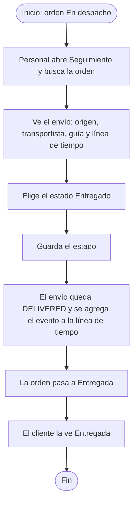
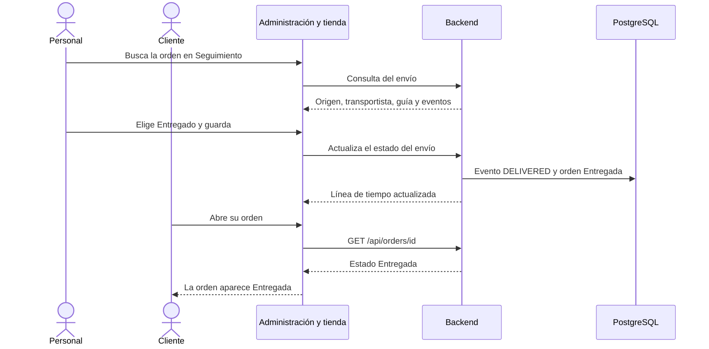

# HP-02: entrega del pedido

El personal registra que el pedido llegó y el cliente ve su orden como entregada.

**Quién:** personal y cliente. **Tiempo:** unos 3 minutos. **Dónde:** local con Docker.

## Antes de empezar

- Una orden pagada, con guía de envío. Sirve la que dejó [HP-01](HP-01-compra-con-tarjeta.md).
- Anota el número de esa orden.

## Diagrama del flujo

## Diagrama de secuencia

## Pasos

| Paso | Qué haces | Resultado esperado | Captura |
|---|---|---|---|
| 1 | Entra como personal. Abre «Seguimiento», escribe el número de orden y pulsa «Buscar» | El envío de esa orden: origen CD-01, transportista LogiExpress, la guía y la línea de tiempo con los eventos ASSIGNED, GUIDE_REQUESTED y GUIDE_ISSUED | [Seguimiento](capturas/hp02-01-seguimiento-de-la-orden.png) |
| 2 | En «Actualizar entrega» elige «Entregado» | El selector queda en Entregado | [Estado elegido](capturas/hp02-02-estado-entregado-elegido.png) |
| 3 | Pulsa «Guardar estado» | El envío pasa a DELIVERED y la línea de tiempo suma el evento de entrega | [Entrega guardada](capturas/hp02-03-entrega-guardada.png) |
| 4 | Entra como el cliente y abre la orden | El estado es «Entregada» y los pasos Cobro, Pagado, Factura y Envío están en verde. Debajo siguen la factura y la sección «Cambios y devoluciones» | [El cliente ve Entregada](capturas/hp02-04-el-cliente-ve-entregada.png) |

## Qué pasa por dentro

En la operación real, la entrega la informa LogiExpress por un webhook (`POST /api/providers/logiexpress/tracking`, protegido con la clave `CARRIER_WEBHOOK_KEY`). La pantalla de Seguimiento deja hacer lo mismo a mano, y es lo que usa esta demostración.

## Qué revisar

- [ ] La búsqueda trae el origen, el transportista y la guía correctos.
- [ ] Después de guardar, la línea de tiempo tiene el evento de entrega.
- [ ] El cliente ve la orden «Entregada».
- [ ] La factura y la guía de la orden siguen visibles.

## Variantes

- **En tránsito:** el mismo selector permite marcar la orden «En tránsito» antes de entregarla.
- **Entrega fallida:** la opción «Entrega fallida» registra que el intento de entrega no se pudo completar.
