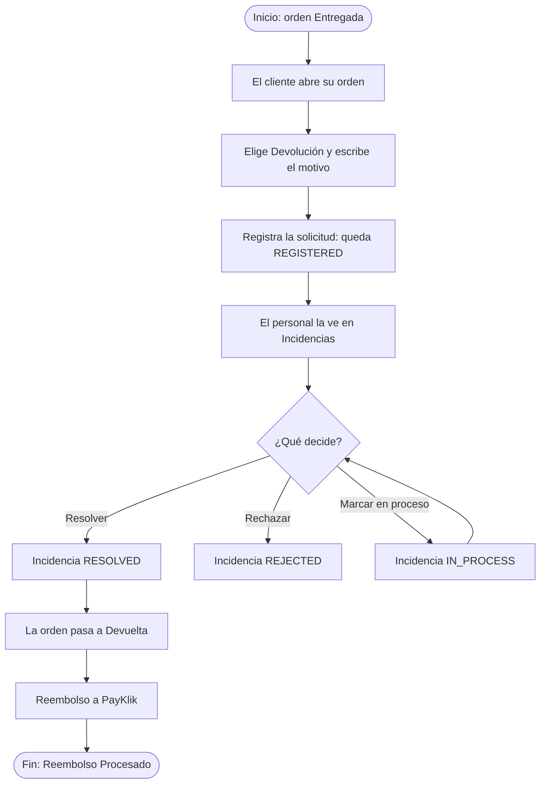
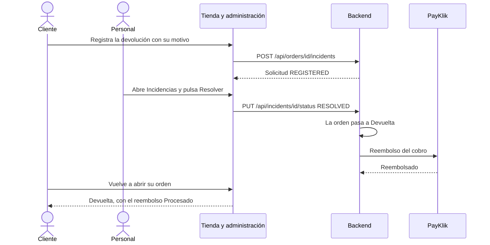

# HP-03: cambio o devolución

El cliente pide la devolución de una orden entregada, el personal la resuelve y el sistema reembolsa el cobro.

**Quién:** cliente y personal. **Tiempo:** unos 4 minutos. **Dónde:** local con Docker.

## Antes de empezar

- Una orden **Entregada**. Sirve la que dejó [HP-02](HP-02-entrega-del-pedido.md).
- Sesión del cliente dueño de esa orden y sesión del personal.

## Diagrama del flujo

## Diagrama de secuencia

## Pasos

| Paso | Qué haces | Resultado esperado | Captura |
|---|---|---|---|
| 1 | Como cliente, abre la orden entregada. Baja a «Cambios y devoluciones», deja el tipo en «Devolución» y escribe el motivo | El formulario con el motivo escrito | [Formulario](capturas/hp03-01-formulario-de-devolucion.png) |
| 2 | Pulsa «Registrar solicitud» | La solicitud aparece en la misma sección, con estado REGISTERED y tu motivo | [Solicitud registrada](capturas/hp03-02-solicitud-registrada.png) |
| 3 | Como personal, abre «Incidencias» | La solicitud en la lista, con el cliente, el monto y los botones «Marcar en proceso», «Resolver» y «Rechazar» | [Incidencia registrada](capturas/hp03-03-incidencia-registrada.png) |
| 4 | Pulsa «Resolver» | Aviso «Incidencia actualizada.» y el estado pasa a RESOLVED | [Incidencia resuelta](capturas/hp03-04-incidencia-resuelta.png) |
| 5 | Como cliente, vuelve a abrir la orden | La orden aparece «Devuelta» y, en «Cambios y devoluciones», la solicitud RESOLVED y «Reembolso Q 2100.00 · Procesado · PAYKLIK-…» | [Devuelta con reembolso](capturas/hp03-05-orden-devuelta-con-reembolso.png) |

## Qué pasa por dentro

Resolver una devolución cambia la orden a «Devuelta» y dispara el reembolso por PayKlik. Si la orden se pagó a crédito y el cargo aún no se abonó, el reembolso espera la confirmación del abono y se retoma solo. Si falla, queda marcado para revisión de Finanzas.

## Qué revisar

- [ ] La solicitud se registra con el motivo escrito y queda en estado REGISTERED.
- [ ] El personal la ve con el cliente y el monto correctos.
- [ ] Al resolver, la orden pasa a «Devuelta».
- [ ] El reembolso aparece como «Procesado» con una referencia `PAYKLIK-…`.
- [ ] Mientras la solicitud estuvo en revisión, el crédito de ese cliente quedó bloqueado para compras nuevas.

## Variantes

- **Cambio en vez de devolución:** elige «Cambio». El personal lo procesa eligiendo el producto de reemplazo en «Incidencias», y el sistema crea la orden de reemplazo.
- **Rechazo:** si el personal pulsa «Rechazar», la solicitud pasa a REJECTED.
