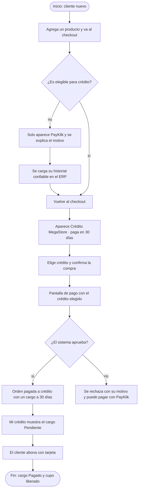
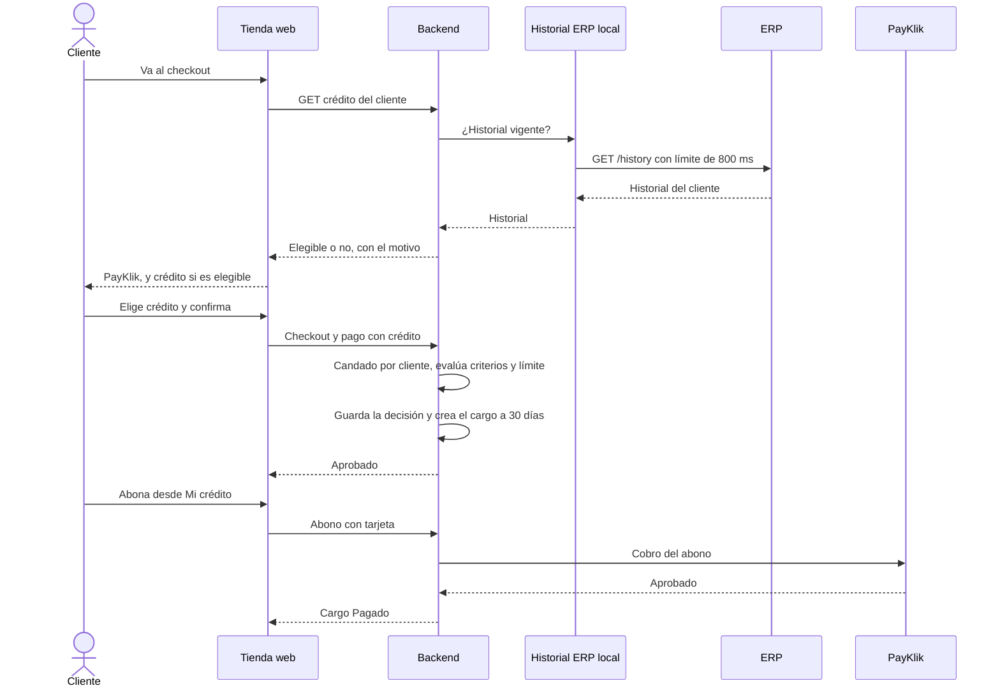

# HP-04: compra a crédito

La regla nueva de la Fase 3: «Compra ahora, paga en 30 días». Un cliente sin historial no ve el crédito y se le explica por qué. Cuando su historial lo permite, compra a crédito, el sistema lo evalúa y aprueba, y él abona el cargo antes del vencimiento.

**Quién:** cliente y personal. **Tiempo:** unos 8 minutos. **Dónde:** local con Docker, porque necesita el ERP simulado.

## Antes de empezar

- Un cliente **nuevo**, con la sesión iniciada. No uses el de HP-01 si ya tiene una devolución, porque una devolución en revisión bloquea el crédito.
- El script [habilitar-credito.sh](scripts/habilitar-credito.sh), que se usa en el paso 3.
- Criterios vigentes, que se ven en la configuración del personal: al menos 3 compras entregadas, Q 30 de importe mínimo, cero incidencias, devoluciones, atrasos y rechazos, límite de Q 5,000 y plazo de 30 días.

## Diagrama del flujo

## Diagrama de secuencia

## Pasos

| Paso | Qué haces | Resultado esperado | Captura |
|---|---|---|---|
| 1 | Agrega un producto, por ejemplo la «Lavadora 18 kg» (Q 3,500), y ve al checkout | En «Cómo pagarás» solo aparece PayKlik, con el motivo debajo: «Se requieren más compras entregadas» | [Checkout sin crédito](capturas/hp04-01-checkout-sin-credito.png) |
| 2 | Abre «Mi crédito» | «Crédito aún no habilitado» con el mismo motivo, el límite de Q 5,000 y 0 compras entregadas | [Mi crédito sin historial](capturas/hp04-02-mi-credito-sin-historial.png) |
| 3 | En una terminal, ejecuta `./FASE\ 3/FLUJOS/scripts/habilitar-credito.sh <correo> http://localhost:8081` | Mensaje «Historial ERP cargado para el cliente…» | |
| 4 | Vuelve al checkout con el mismo carrito, escribe la dirección y marca «Crédito MegaStore · paga en 30 días» | La opción aparece y el texto dice «Crédito disponible: Q 5000.00. La aprobación se confirma al pagar.» | [Checkout con crédito](capturas/hp04-03-checkout-con-credito.png) |
| 5 | Pulsa «Confirmar compra» y «Pagar ahora» | La pantalla de pago ya trae el crédito elegido y dice «Historial confiable y pagos al día. Disponible: Q 5000.00» | [Pago a crédito](capturas/hp04-04-pago-a-credito.png) |
| 6 | Pulsa «Pagar Q 3500.00». No se cobra nada ahora | La orden se aprueba y avanza como una compra normal: factura, guía y estado «En despacho» | [Orden a crédito](capturas/hp04-05-orden-a-credito.png) |
| 7 | Abre «Mi crédito» | «Crédito habilitado». En «Solicitudes de crédito», la orden «Aprobada». Debajo, el cargo de Q 3,500 «Pendiente», con su fecha de vencimiento a 30 días y el botón «Pagar saldo» | [Mi crédito con cargo](capturas/hp04-06-mi-credito-con-cargo.png) |
| 8 | Escribe un número de tarjeta de 16 dígitos y el CVV arriba, y pulsa «Pagar saldo» | Aviso «Abono registrado.» y el cargo pasa a «Pagado» | [Saldo pagado](capturas/hp04-07-saldo-pagado.png) |
| 9 | Como personal, abre `/administracion/clientes` y entra a ese cliente | «Evaluación automática de crédito»: crédito habilitado, compras entregadas, atrasos, rechazos, incidencias, devoluciones, y los desplegables «Criterios vigentes» y «Solicitudes anteriores» | [Evaluación del personal](capturas/hp04-08-evaluacion-de-credito-del-personal.png) |

## Qué pasa por dentro

El historial del ERP se lee a una proyección local con un límite de 800 ms, así que la venta nunca espera al ERP. Evaluar y cargar ocurren con un candado sobre el cliente, de modo que dos compras simultáneas no superan el límite. La decisión, aprobada o rechazada, queda guardada con el detalle de la evaluación y auditada. El diseño completo está en el [ADR-0010](../DDA/ADR/0010-evaluacion-de-credito-propio.md).

## Qué revisar

- [ ] Sin historial, el checkout solo ofrece PayKlik y dice por qué.
- [ ] Con historial confiable aparece la opción de crédito con el cupo disponible.
- [ ] Pagar a crédito no cobra nada en ese momento y la orden avanza normal.
- [ ] El cargo aparece «Pendiente» con vencimiento a 30 días.
- [ ] El abono lo deja «Pagado» y el cupo vuelve a quedar disponible.
- [ ] El personal ve la evaluación y la solicitud aprobada del cliente.

## Variantes

- **El crédito se rechaza:** si el cliente tiene un saldo vencido, una solicitud de cambio o devolución en revisión, un atraso o un rechazo, el crédito no se ofrece y se explica el motivo. Es el caso de un cliente que acaba de pedir una devolución.
- **El ERP no responde:** sin historial vigente, la opción de crédito desaparece y el cliente sigue con PayKlik. Se prueba con `PUT /api/simulation/erp` en modo `DOWN`, y se vuelve a `NORMAL` después.
- **Cambiar las reglas:** el administrador puede editar los parámetros `credit.*` en Configuración (ver [HP-07](HP-07-consultas-del-personal.md)); aplican a la siguiente compra.
