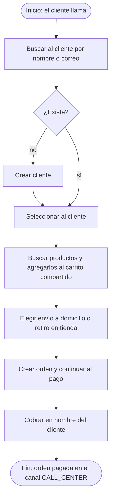
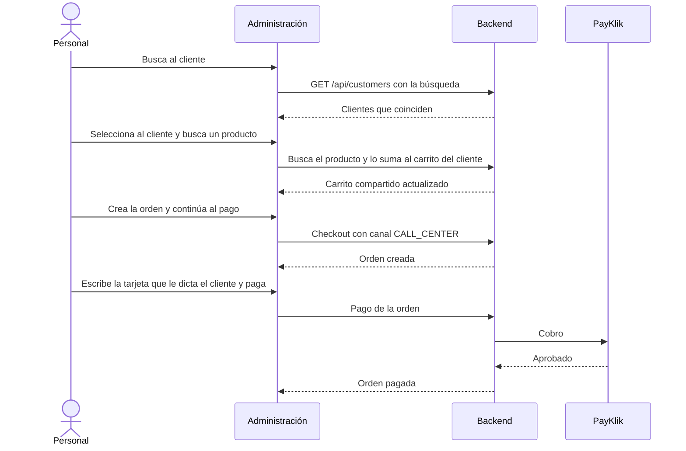

# HP-05: venta asistida

El personal del call center arma una compra por teléfono en nombre de un cliente: lo busca, agrega los productos, crea la orden y la cobra.

**Quién:** personal. **Tiempo:** unos 4 minutos. **Dónde:** local con Docker.

## Antes de empezar

- Sesión de personal con un rol que pueda vender: administrador, agente de call center, encargado de tienda o empleado de tienda.
- Un cliente existente. Sirve cualquiera de las cuentas de demostración o el de [HP-04](HP-04-compra-a-credito.md).

## Diagrama del flujo

## Diagrama de secuencia

## Pasos

| Paso | Qué haces | Resultado esperado | Captura |
|---|---|---|---|
| 1 | Como personal, abre «Venta asistida». Escribe el correo del cliente y pulsa «Buscar cliente» | Aparece el cliente en la lista de resultados. También hay un botón «Crear cliente» | [Buscar cliente](capturas/hp05-01-buscar-cliente.png) |
| 2 | Pulsa sobre el cliente | «Cliente seleccionado: …» y se habilitan «Buscar producto», el carrito compartido y las opciones de entrega y pago | [Cliente seleccionado](capturas/hp05-02-cliente-seleccionado.png) |
| 3 | Escribe «Laptop» en «Buscar producto» y pulsa «Buscar producto» | «Laptop 14 pulgadas · Q 5600.00» con el botón «Agregar EL-002» | [Buscar producto](capturas/hp05-03-buscar-producto.png) |
| 4 | Pulsa «Agregar EL-002» | El producto aparece en el carrito compartido con «Sumar unidad» y «Quitar producto». «Cómo pagarás» muestra las opciones que le corresponden a ese cliente | [Producto en el carrito](capturas/hp05-04-producto-en-el-carrito.png) |
| 5 | Deja «Envío a domicilio», escribe la dirección y mira las opciones de pago | Dirección y forma de pago a la vista; abajo, el botón «Crear orden y continuar al pago» | [Entrega y pago](capturas/hp05-05-entrega-y-pago.png) |
| 6 | Pulsa «Crear orden y continuar al pago» | Se crea la orden a nombre del cliente y pasas a su pantalla de pago, con los métodos tarjeta, transferencia y billetera digital (y el crédito, si el cliente lo tiene y le alcanza) | [Orden creada](capturas/hp05-06-orden-creada-por-el-call-center.png) |
| 7 | Elige tarjeta, escribe el número y el CVV que dicta el cliente, y pulsa «Pagar Q 5600.00» | El pago se procesa | [Pago en nombre del cliente](capturas/hp05-07-pago-en-nombre-del-cliente.png) |
| 8 | Espera unos segundos | La orden queda pagada, con factura y guía, igual que una compra hecha por el cliente | [Orden pagada](capturas/hp05-08-orden-pagada-canal-call-center.png) |

## Qué pasa por dentro

El carrito es el mismo que ve el cliente en la tienda: si lo había empezado, el personal lo continúa. La orden queda registrada en el canal `CALL_CENTER`, lo que permite distinguirla en los reportes y en la auditoría.

## Qué revisar

- [ ] La búsqueda encuentra al cliente por correo.
- [ ] El producto se suma al carrito del cliente.
- [ ] La orden queda a nombre del cliente y no del personal.
- [ ] El pago funciona y la orden avanza a factura y envío.
- [ ] La orden aparece con el canal `CALL_CENTER` en la administración.

## Variantes

- **Cliente nuevo:** si no aparece en la búsqueda, «Crear cliente» permite registrarlo en el momento.
- **Retiro en tienda:** en «Entrega», elige «Retiro T-01 · Tienda 01» (u otra tienda) en lugar del envío a domicilio.
- **Desde la ficha del cliente:** en `/administracion/clientes`, abre al cliente y pulsa «Continuar carrito / crear venta asistida».
