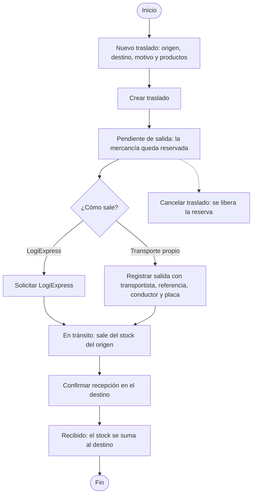
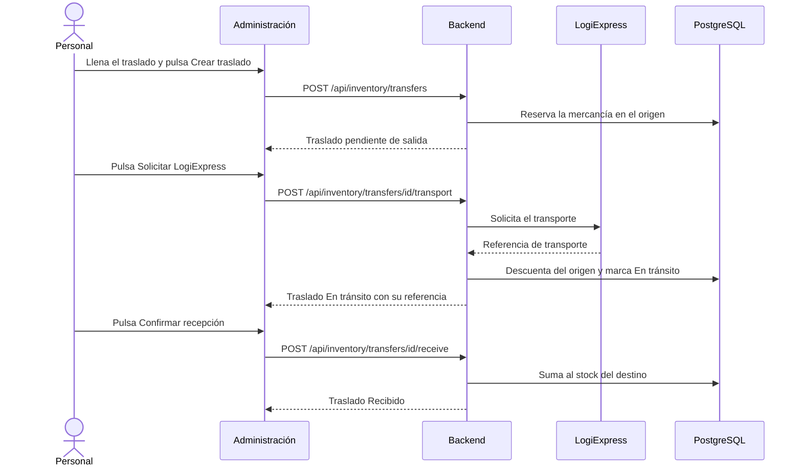

# HP-06: traslado de mercancía

El personal repone una tienda moviendo stock desde un centro de distribución: crea el traslado, solicita el transporte a LogiExpress y confirma la recepción.

**Quién:** personal con permiso de traslados (administrador o logística). **Tiempo:** unos 3 minutos. **Dónde:** local con Docker.

## Antes de empezar

- Sesión de personal.
- Stock del producto en el centro de distribución de origen. Los datos de prueba dejan 200 unidades de cada producto en CD-01 y CD-02.

## Diagrama del flujo

## Diagrama de secuencia

## Pasos

| Paso | Qué haces | Resultado esperado | Captura |
|---|---|---|---|
| 1 | Abre «Traslados». En «Nuevo traslado» elige origen `CD-01`, destino `T-01`, escribe el motivo, busca «Laptop», elígela y pon cantidad 5 | El formulario completo, con «5 × Laptop 14 pulgadas» | [Nuevo traslado](capturas/hp06-01-nuevo-traslado.png) |
| 2 | Pulsa «Crear traslado» | «Traslado #… · Pendiente de salida», con `CD-01 → T-01 · Reposición de tienda`, los productos y el historial con «Mercancía reservada para traslado». Hay botones «Solicitar LogiExpress» y «Cancelar traslado», y el formulario del transportista alternativo | [Traslado pendiente](capturas/hp06-02-traslado-pendiente.png) |
| 3 | Pulsa «Solicitar LogiExpress» y espera unos segundos | «En tránsito», con «Transportista: LogiExpress · Referencia: LOGIEXPRESS-…» y un nuevo evento «Salida con LogiExpress». Aparece «Confirmar recepción» | [En tránsito](capturas/hp06-03-traslado-en-transito.png) |
| 4 | Pulsa «Confirmar recepción» | El traslado pasa a «Recibido» y el botón desaparece | [Recibido](capturas/hp06-04-traslado-recibido.png) |

Si la pantalla no cambia sola en el paso 3, pulsa «Actualizar traslados»: la solicitud a LogiExpress se resuelve en segundo plano.

## Qué pasa por dentro

Un traslado tiene tres momentos y cada uno toca el stock de forma distinta: al crearlo, la mercancía queda **reservada** en el origen; al despacharlo, **sale** del stock del origen; al confirmar la recepción, **se suma** al destino. Por eso un traslado cancelado antes de salir solo libera la reserva.

## Qué revisar

- [ ] El traslado se crea «Pendiente de salida» con la mercancía reservada.
- [ ] Con LogiExpress pasa a «En tránsito» y trae una referencia `LOGIEXPRESS-…`.
- [ ] «Confirmar recepción» lo deja «Recibido».
- [ ] El historial muestra los tres eventos, con la hora y quién lo hizo.
- [ ] En «Inventario», el stock de la laptop baja 5 en CD-01 y sube 5 en T-01.

## Variantes

- **Transporte propio:** en el formulario «Transportista alternativo» escribe el transportista, la referencia, el conductor y la placa, y pulsa «Registrar salida». El resto del flujo es igual.
- **Cancelar:** mientras esté «Pendiente de salida», «Cancelar traslado» libera la reserva.
- **Estado de los traslados:** el filtro «Estado» de la lista muestra Pendiente de salida, En tránsito, Recibido y Cancelado.
