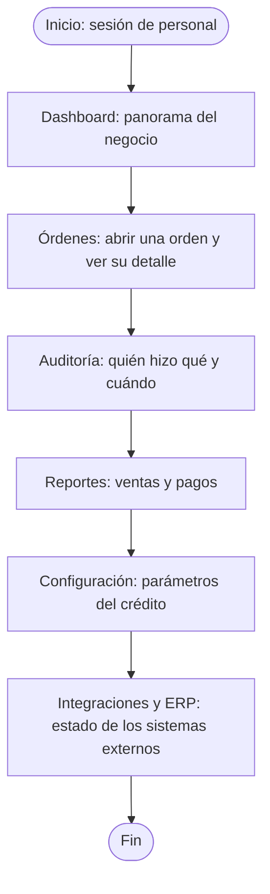
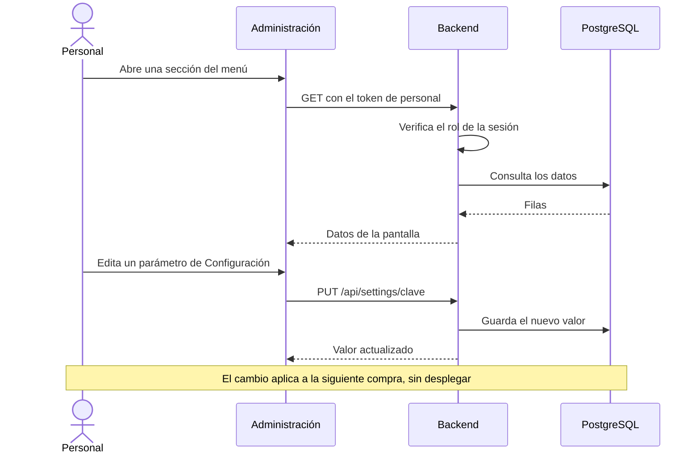

# HP-07: consultas del personal

El recorrido de cierre de una demostración: el personal revisa el resultado de lo que se hizo en los otros flujos y ajusta las reglas del crédito.

**Quién:** personal, con rol de administrador. **Tiempo:** unos 4 minutos. **Dónde:** local con Docker, después de haber corrido los otros flujos, para que haya datos.

## Antes de empezar

- Sesión de personal con rol de administrador.
- Haber ejecutado al menos [HP-01](HP-01-compra-con-tarjeta.md) y [HP-04](HP-04-compra-a-credito.md).

## Diagrama del flujo

## Diagrama de secuencia

## Pasos

| Paso | Qué haces | Resultado esperado | Captura |
|---|---|---|---|
| 1 | Abre «Dashboard» | «Resumen general»: ventas y órdenes de los últimos 30 días, incidencias abiertas, reservas activas y las órdenes recientes con su estado | [Dashboard](capturas/hp07-01-dashboard.png) |
| 2 | Abre «Órdenes» y entra a una | Detalle con el avance Cobro, Pagado, Factura, Envío y Entrega, los productos, la dirección, la guía y la factura electrónica | [Detalle de la orden](capturas/hp07-02-detalle-de-la-orden.png) |
| 3 | Abre «Auditoría» | La lista de acciones registradas, con quién las hizo | [Auditoría](capturas/hp07-03-auditoria.png) |
| 4 | Abre «Reportes» | Los reportes de ventas y de pagos | [Reportes](capturas/hp07-04-reportes.png) |
| 5 | Abre «Configuración» | Los parámetros del sistema; los de crédito empiezan con `credit.`, con «Editar» en cada uno | [Configuración del crédito](capturas/hp07-05-configuracion-del-credito.png) |
| 6 | Abre «Integraciones» | El estado de los sistemas externos | [Integraciones](capturas/hp07-06-integraciones.png) |
| 7 | Abre «ERP y conciliación» | Los lotes de ventas que se envían al ERP, con su estado | [ERP y conciliación](capturas/hp07-07-erp-y-conciliacion.png) |

## Cambiar una regla del crédito

Es la demostración más vistosa de este flujo:

1. En «Configuración», pulsa «Editar» junto a `credit.limit` y cambia el límite de 5000 a 1000.
2. Con un cliente que tenga crédito, intenta una compra de más de Q 1,000: el checkout dice «El crédito disponible no cubre esta compra.»
3. Vuelve a poner 5000.

El cambio aplica a la siguiente compra, sin reiniciar ni desplegar nada.

## Qué revisar

- [ ] El dashboard muestra las órdenes que se crearon en los otros flujos.
- [ ] El detalle de la orden trae la factura y la guía.
- [ ] La auditoría registra las acciones hechas.
- [ ] La configuración muestra los ocho parámetros `credit.*` y permite editarlos.
- [ ] Un cambio en `credit.limit` se refleja en el siguiente checkout.

## Variantes

- **Otros roles:** si entras con un rol distinto al administrador, el menú muestra solo las secciones permitidas (por ejemplo, finanzas ve auditoría, reportes y facturas, pero no usuarios ni configuración).
