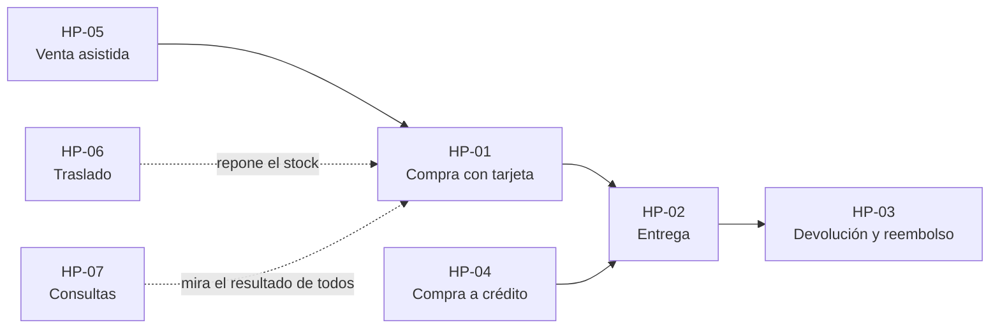

# Flujos principales de SGO-Logic

Recorridos completos, paso a paso, del camino feliz de cada proceso del sistema. Sirven para dos cosas: **demostrar** el sistema con un guion que sale bien, y **probarlo a mano** con resultados esperados claros.

Todos se ejecutaron de punta a punta el 14 de octubre de 2026 con el sistema completo en local, y de ahí salen las capturas. Los números de orden, las referencias de envío y las fechas cambian en cada instalación.

## Los flujos

| Flujo | Qué demuestra | Quién | Tiempo |
|---|---|---|---|
| [HP-01 Compra con tarjeta](HP-01-compra-con-tarjeta.md) | De crear la cuenta a tener la orden pagada, facturada y con guía de envío | Cliente | 5 min |
| [HP-02 Entrega del pedido](HP-02-entrega-del-pedido.md) | El personal registra la entrega y el cliente la ve | Personal y cliente | 3 min |
| [HP-03 Cambio o devolución](HP-03-cambio-o-devolucion.md) | El cliente pide una devolución, el personal la resuelve y se reembolsa | Cliente y personal | 4 min |
| [HP-04 Compra a crédito](HP-04-compra-a-credito.md) | La regla nueva de la Fase 3: crédito propio, de la evaluación al abono | Cliente y personal | 8 min |
| [HP-05 Venta asistida](HP-05-venta-asistida.md) | El call center compra por teléfono en nombre de un cliente | Personal | 4 min |
| [HP-06 Traslado de mercancía](HP-06-traslado-de-mercancia.md) | Mover stock de un centro de distribución a una tienda | Personal | 3 min |
| [HP-07 Consultas del personal](HP-07-consultas-del-personal.md) | Dashboard, detalle de orden, auditoría, reportes y configuración | Personal | 4 min |

Cada documento trae su diagrama de flujo, su diagrama de secuencia, los pasos con la captura y el resultado esperado de cada uno, y una lista para marcar durante la prueba.

## Cómo se conectan



## Dónde ejecutarlos

| Entorno | Qué funciona |
|---|---|
| **Local con Docker (recomendado)** | Todo. Es el único que tiene Kafka, los seis proveedores y el ERP, así que pago, factura, envío, devoluciones, crédito y traslados se ven completos |
| **Nube (Render)** | Vista parcial: catálogo, cuentas, carrito y consultas. Sin Kafka ni proveedores, el pago, el crédito y los traslados no se demuestran completos |

Para levantar el entorno local, desde `FASE 2/`:

```bash
./iniciar.sh
```

La tienda queda en `http://localhost:8081` y la administración en `http://localhost:8081/administracion`. Para empezar de cero, con la base limpia, usa `RESET_SEED=true` en `FASE 2/.env` antes de `./iniciar.sh`, o `docker compose down -v` y volver a levantar. En la nube, abre la tienda unos minutos antes de presentar para que los servicios estén despiertos.

## Cuentas y datos de prueba

| Para qué | Dato |
|---|---|
| Personal | Usuario `admin`, contraseña `admin123`, en `/administracion/login` |
| Cliente de demostración | Cualquiera de las cuentas sembradas, contraseña `cliente123`: `maria@example.com`, `lucia@example.com`, `ana@example.com`, `carlos@example.com`, `jorge@example.com` |
| Cliente nuevo | Se crea en «Crear una», con la contraseña que quieras. Es lo más limpio para un recorrido completo |
| Tarjeta de prueba | Cualquier número de 16 dígitos, por ejemplo `4242 4242 4242 4242`, con cualquier CVV |
| Productos | Los 12 del catálogo, por ejemplo «Estufa de 4 quemadores» (Q 2,100) y «Laptop 14 pulgadas» (Q 5,600) |

Para el flujo de crédito hace falta que el cliente tenga historial en el ERP. El script [habilitar-credito.sh](scripts/habilitar-credito.sh) se lo carga en un segundo:

```bash
./FASE\ 3/FLUJOS/scripts/habilitar-credito.sh cliente@example.com http://localhost:8081
```

## Guion de demostración sugerido

Unos 20 minutos, en este orden, porque cada paso deja listo el siguiente:

1. **HP-01.** Crea un cliente nuevo y compra con tarjeta. Muestra la orden con su factura y su guía.
2. **HP-02.** Pasa al personal y marca la orden como entregada. Vuelve al cliente y muestra que la ve entregada.
3. **HP-03.** Con esa misma orden entregada, pide una devolución, resuélvela como personal y muestra el reembolso.
4. **HP-04.** Crea un segundo cliente. Muestra que no tiene crédito y por qué, cárgale el historial con el script, compra a crédito y abona.
5. **HP-05.** Como personal, haz una venta asistida para ese cliente.
6. **HP-06.** Mueve mercancía entre un centro de distribución y una tienda.
7. **HP-07.** Cierra con el dashboard y la configuración de los parámetros del crédito.

Si el tiempo es poco, los tres que más muestran son HP-01, HP-04 y HP-03.

## Casos de prueba

| ID | Precondición | Resultado esperado | Prueba automatizada equivalente |
|---|---|---|---|
| HP-01 | Cliente nuevo | Orden pagada, con factura y guía, y avisos al cliente | `compra.spec.ts` |
| HP-02 | Orden pagada con guía | Orden «Entregada» para el cliente | `fase2-completa.spec.ts` (devolución desde la orden) |
| HP-03 | Orden entregada | Orden «Devuelta» y reembolso procesado | `fase2-completa.spec.ts` |
| HP-04 | Cliente con historial ERP | Crédito aprobado, cargo a 30 días y abono que lo deja «Pagado» | `fase3-credito.spec.ts` (E01 a E05) y `test_integracion.py` |
| HP-05 | Cliente existente | Orden en canal CALL_CENTER, pagada | Sin prueba E2E propia: se verificó con este recorrido |
| HP-06 | Stock en el centro de distribución | Traslado «Recibido» y stock movido | Sin prueba E2E propia: se verificó con este recorrido |
| HP-07 | Sesión de personal | Todas las pantallas cargan con datos | `backoffice.spec.ts` y `permisos.spec.ts` |

Las pruebas automatizadas están en `FASE 2/frontend/e2e/` y `FASE 3/`; la guía para correrlas está en [GUIA-DEMO-PRUEBAS.md](../GUIA-DEMO-PRUEBAS.md).
