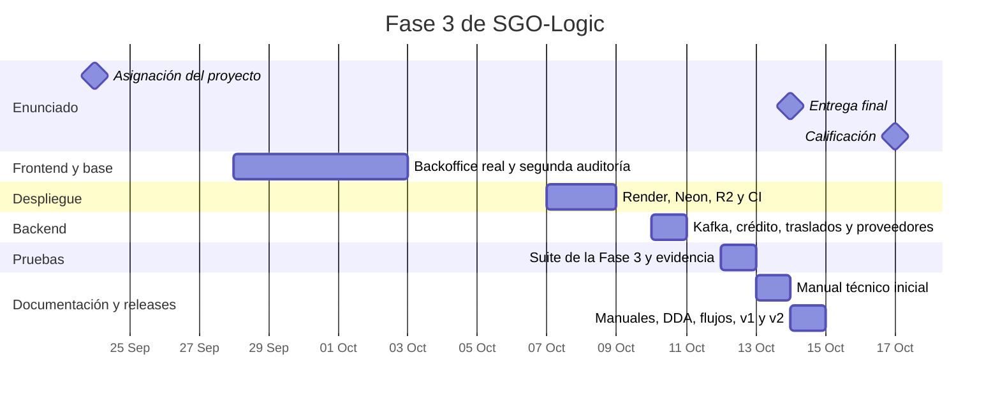
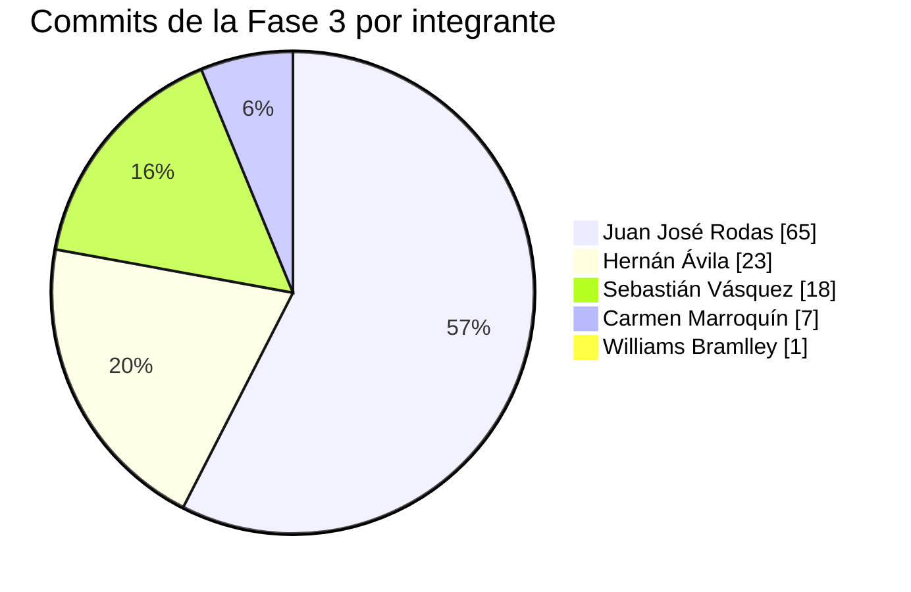

# Gestión del proyecto: Fase 3

Cómo se organizó y se llevó el trabajo de la Fase 3: quién hizo qué, en qué fechas, con qué herramientas, qué salió mal y qué se aprendió. Se reconstruyó a partir del historial de git, los pull requests, el CI y la [bitácora](../BITACORA.md), igual que el [Scrum de la Fase 2](../FASE%202/Scrum/Scrum%20-%20Grupo%203.md). Donde no hay evidencia en el repositorio, el documento lo dice y no la inventa.

## Equipo y roles

Los roles del equipo son los de la Fase 2, y se mantuvieron.

| Integrante | Carnet | Rol en el equipo | Rol de Scrum |
|---|---|---|---|
| Hernán Ricardo Ávila Castillo | 9516085 | Backend 1: núcleo comercial | Dev Team |
| Sebastián Alejandro Vásquez Cartagena | 202109114 | Backend 2: transacciones e integraciones | Dev Team |
| Juan José Rodas Mansilla | 202200389 | Frontend 1: cliente y compra omnicanal | Scrum Master |
| Williams Bramlley Constanza Oscal | 199919737 | Frontend 2: operación interna y backoffice | Product Owner |
| Carmen María Marroquín Llamas | 202001132 | Documentación, Docker y pruebas E2E | Dev Team |

## Cronograma

Fechas del enunciado: asignación el 24 de septiembre de 2026, entrega final el 14 de octubre y calificación el 17 de octubre.

## Backlog de la Fase 3

El trabajo de la fase, con quien lo hizo según el historial de commits. Todo está terminado.

| ID | Historia | Responsable | Estado |
|---|---|---|---|
| PB-F3-01 | Como cliente, quiero comprar a crédito a 30 días y abonar mi saldo, para comprar sin pagar en el momento | Sebastián | Hecho |
| PB-F3-02 | Como Finanzas, quiero que cada solicitud de crédito se decida con el historial real del cliente y quede registrada, para poder justificarla | Sebastián | Hecho |
| PB-F3-03 | Como equipo, quiero Kafka y los seis proveedores externos en el docker-compose, para que los pasos asíncronos se reintenten sin perderse | Sebastián | Hecho |
| PB-F3-04 | Como personal, quiero ubicaciones, traslados y transporte alternativo, para reponer las tiendas | Sebastián | Hecho |
| PB-F3-05 | Como cliente, quiero registro e inicio de sesión reales, para tener mi propio carrito y mis compras | Juan José | Hecho |
| PB-F3-06 | Como equipo, quiero desplegar en Render, Neon y Cloudflare R2, para tener la aplicación en la nube | Juan José y Hernán | Hecho |
| PB-F3-07 | Como equipo, quiero un CI en GitHub Actions que corra las pruebas y condicione el deploy | Juan José y Carmen | Hecho |
| PB-F3-08 | Como equipo, quiero al menos 5 pruebas por categoría: unitarias, integración, E2E, carga y estrés | Carmen | Hecho: 242 casos |
| PB-F3-09 | Como lector, quiero un manual técnico y un manual de usuario | Williams (primera versión), Hernán (versión actual) | Hecho |
| PB-F3-10 | Como equipo, quiero la arquitectura de la fase documentada: ADR, drivers, escenarios, casos de uso y diagramas | Hernán | Hecho |
| PB-F3-11 | Como equipo, quiero flujos del camino feliz para demostrar y probar | Hernán | Hecho |
| PB-F3-12 | Como equipo, quiero git-flow con `main` y releases | Hernán | Hecho: `v1` y `v2` |

## Cómo se trabajó

- **Control de versiones.** Git-flow con `develop` como rama de integración, una rama `feature/<carnet>-<tema>` por tarea y `main` para las entregas. Las reglas están en [CONTRIBUTING.md](../FASE%201/CONTRIBUTING.md), con la actualización de la Fase 3.
- **Integración continua.** Cada push a `develop` y a las ramas `feature/*`, y cada pull request, corre el [CI](../.github/workflows/ci.yml): pruebas del backend, del frontend y la suite de la Fase 3.
- **Despliegue.** Render despliega un commit de `develop` solo si pasan los checks del CI ([ADR-0011](DDA/ADR/0011-cicd-y-despliegue-en-la-nube.md)).
- **Versiones.** Un tag `vN` por release, con sus notas en el [CHANGELOG](../CHANGELOG.md).
- **Comunicación.** Los cambios se explican en la descripción de cada pull request y en la bitácora; las decisiones, en los ADR.
- **Tablero.** El repositorio no tiene un tablero Kanban de esta fase. El avance se sigue por pull requests, ramas y el backlog de arriba.

## Distribución del trabajo

Commits sin contar merges, desde el 24 de septiembre, con las líneas agregadas y quitadas sin contar imágenes, PDF ni `package-lock.json`.

| Integrante | Commits | Líneas (+ / −) | Dónde se nota |
|---|---:|---:|---|
| Juan José Rodas (202200389) | 65 | 13,204 / 1,430 | Backoffice, cuentas de cliente, despliegue en Render, Neon y R2, y el CI |
| Hernán Ávila (9516085) | 23 | 2,959 / 1,217 | Frontend en Docker, corrección del proxy en Render, manuales, DDA, flujos, releases |
| Sebastián Vásquez (202109114) | 18 | 5,478 / 4,157 | Kafka, proveedores, crédito, devoluciones, traslados |
| Carmen Marroquín (202001132) | 7 | 1,317 / 81 | Suite de pruebas de la Fase 3 y su integración al CI |
| Williams Bramlley (199919737) | 1 | 741 / 0 | Primera versión del manual técnico |

## Incidentes y cómo se resolvieron

| Fecha | Qué pasó | Cómo se resolvió |
|---|---|---|
| 8 de octubre | El frontend en Render caía con «host not found in upstream»: un servicio gratuito no recibe tráfico por la red privada, así que el nombre interno del backend no resolvía | El frontend pasó a usar la URL pública del backend (`BACKEND_URL`), con un `resolver` en nginx |
| 12 y 13 de octubre | Los deploys del backend fallaban en el health check, porque la base de Neon no tenía las migraciones nuevas y `/api/products` daba 500 | Se aplicaron las migraciones a Neon con `aplicar-migraciones-nube.sh`; quedó documentado que se aplican a mano antes de un deploy |
| 13 al 15 de octubre | El CI de la Fase 3 fallaba de forma intermitente: una prueba distinta cada vez (`I08`, `E02`, una del carrito) y una falla de red al compilar con Maven | Se relanzaron los jobs fallidos. La causa de fondo, pruebas sensibles al tiempo, sigue abierta |
| 14 de octubre | La aplicación en Render daba 502 de forma intermitente: el backend se reiniciaba por falta de memoria con los consumidores de Kafka | Se fijó el heap de la JVM con `JAVA_TOOL_OPTIONS` y se desactivó el arranque de los listeners de Kafka con `SPRING_KAFKA_LISTENER_AUTO_STARTUP`; el equipo confirmó que funcionó |
| 14 de octubre | Aparecieron copias duplicadas de archivos («… 2.png») en la carpeta del repo, que se colaron en un commit | Se quitaron del repositorio. El origen más probable es la sincronización de iCloud sobre `Documents` |

## Riesgos abiertos

| Riesgo | Efecto | Qué haría falta |
|---|---|---|
| Pruebas E2E e integración intermitentes | El CI puede ponerse en rojo sin que el código falle, y con él se bloquea el deploy automático | Que las pruebas esperen condiciones en lugar de leerlas de inmediato, o permitir un reintento en el CI |
| La nube es una vista parcial | En Render no hay Kafka ni proveedores, así que el pago y el crédito solo se demuestran completos con docker-compose | Un plan de pago de Render o un servidor propio |
| Arranque en frío de Render | La primera visita tras un rato de inactividad puede dar 502 durante un par de minutos | Abrir la aplicación antes de una presentación |
| Participación desigual | Un integrante concentra más de la mitad de los commits y otro tiene uno solo | Repartir explícitamente las tareas de cada sprint |

## Releases

| Versión | Fecha | Contenido |
|---|---|---|
| `v0.1-fase1` | 15 de agosto | Entrega de la Fase 1 |
| `v1` | 14 de octubre | Crédito propio, Kafka, cuentas de cliente, despliegue en la nube, CI y 242 pruebas |
| `v2` | 15 de octubre | Documentación completa de la fase: ADR, casos de uso, flujos, correcciones por feedback y evidencia refrescada |

El detalle de cada una está en el [CHANGELOG](../CHANGELOG.md).

## Retrospectiva

**Qué salió bien**
- El crédito, Kafka y los traslados entraron completos y con pruebas: 242 casos en las cinco categorías.
- El sistema quedó desplegado en la nube con Docker y con un gate de pruebas antes del deploy.
- La documentación final describe lo que realmente se construyó, y los documentos de la Fase 2 que quedaron viejos llevan una nota de actualización.

**Qué salió mal**
- La documentación de la arquitectura se escribió al final, el 14 y 15 de octubre, en lugar de acompañar a la implementación. Eso hizo que algunos documentos de la Fase 2 contradijeran el código hasta ese momento.
- Los commits quedaron muy concentrados en una persona, y 35 no siguen el formato `carnet: mensaje`.
- Las pruebas sensibles al tiempo pusieron el CI en rojo varias veces, justo en los días de la entrega.
- El problema de memoria de la nube se detectó tarde, ya con la aplicación en uso.

**Mejoras propuestas**
- Documentar cada decisión cuando se toma, con su ADR, y no al cierre.
- Repartir las tareas de documentación y de pruebas entre todos desde el inicio de cada sprint.
- Estabilizar las pruebas intermitentes antes de agregar más.
- Revisar el consumo de memoria de la aplicación con la configuración de la nube antes de desplegar.
- Mantener el repositorio fuera de carpetas que se sincronizan con servicios como iCloud.

## Habilidades blandas

- **Trabajo en equipo.** Cada integrante tiene un rol fijo desde la Fase 2, y el backlog de la fase muestra cómo se repartió el trabajo.
- **Comunicación.** Las descripciones de los pull requests, la bitácora y los ADR dejan por escrito qué se hizo y por qué.
- **Resolución de conflictos.** El repositorio no guarda registro de desacuerdos ni de cómo se resolvieron, así que no se documenta aquí.
