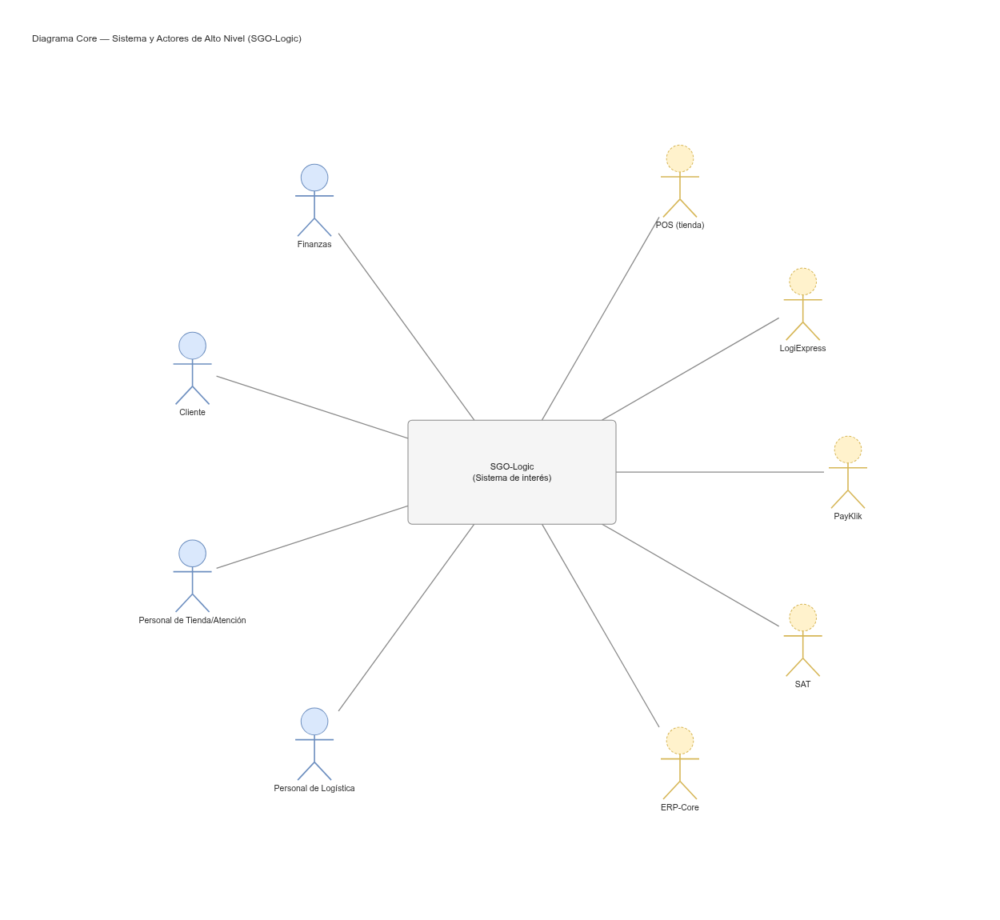
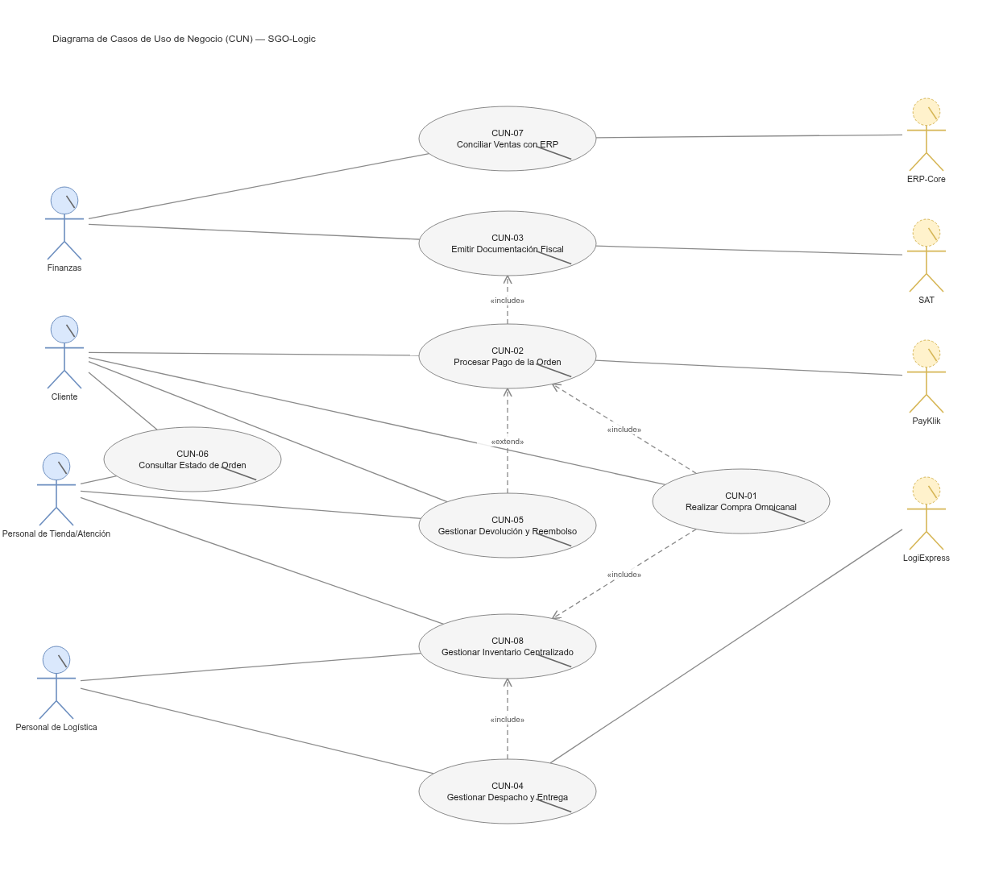
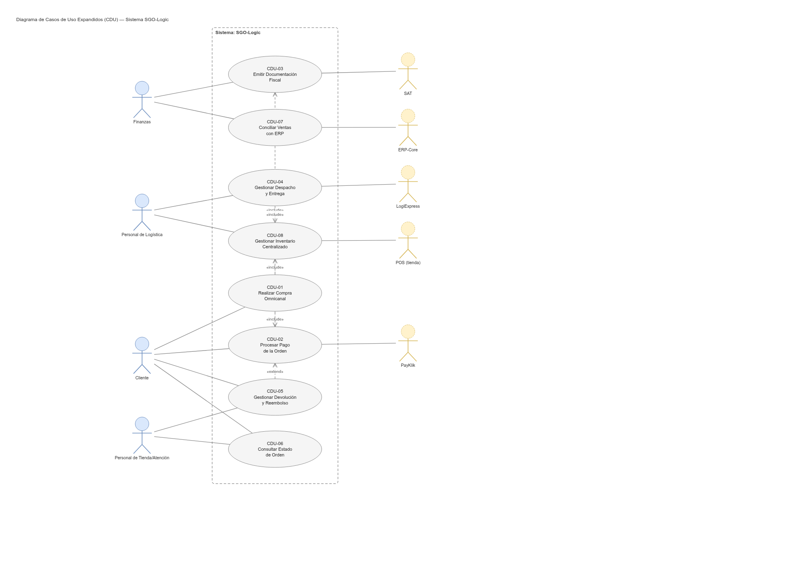
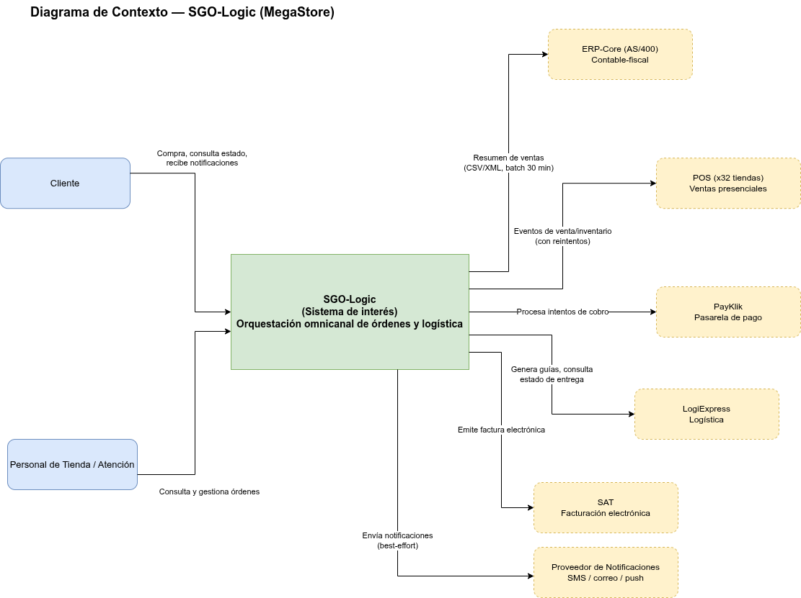
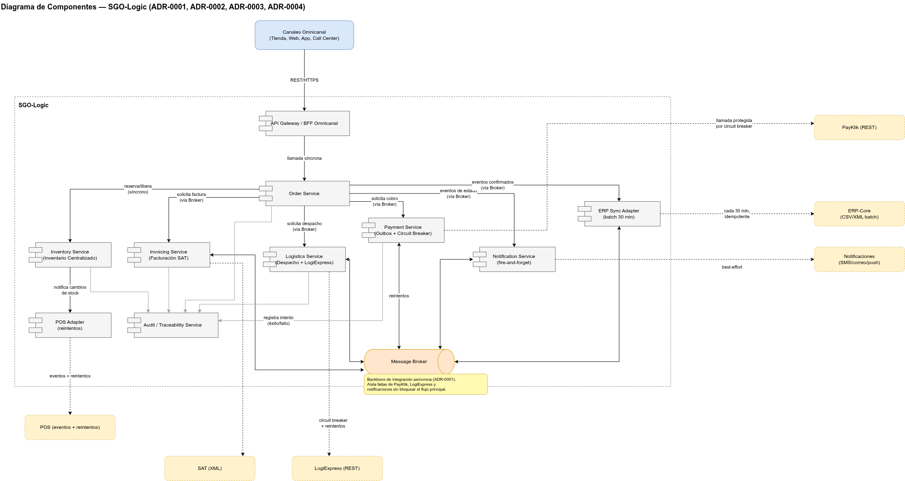
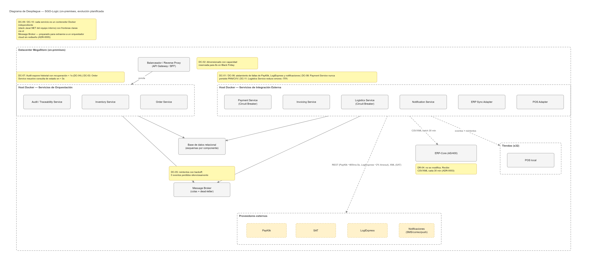
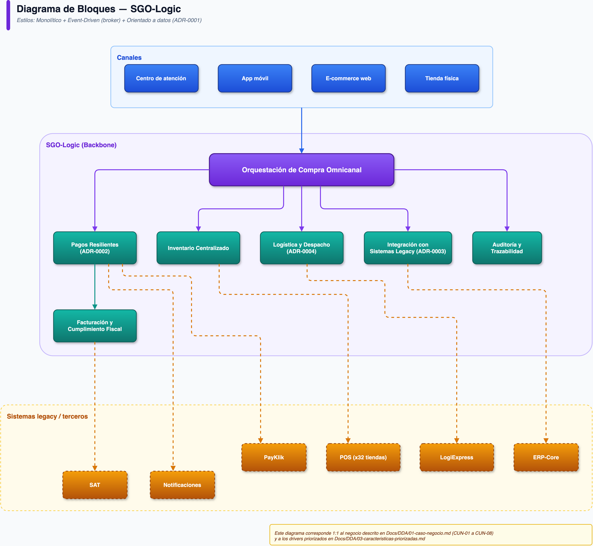

# SGO-Logic — Informe Principal, Proyecto Fase 1 (AYD2)

Sistema de Gestión de Órdenes y Logística Omnicanal (SGO-Logic) para **MegaStore** — Documento de Definición de Arquitectura, diagramas, presentación y prototipo. Elaborado para el curso Análisis y Diseño de Sistemas 2, Sección A (USAC), según el enunciado oficial ([`Docs/Enunciado/Proyecto Fase 1.pdf`](Docs/Enunciado/Proyecto%20Fase%201.pdf)).

> Repositorio: [`AYD2_A_2S2025_PROYECTO_G3`](https://github.com/hricardoavilac/AYD2_A_2S2025_PROYECTO_G3) (Sección A, Grupo 3).

Este README consolida, en un solo lugar, todo lo que el enunciado exige entregar. Cada sección trae los datos completos y enlaza al documento fuente para el detalle exhaustivo.

## Índice

- [Resumen ejecutivo](#resumen-ejecutivo)
- [Objetivos y competencias](#objetivos-y-competencias)
- [Entregable 1 — Documento de Definición de Arquitectura (DDA)](#entregable-1--documento-de-definición-de-arquitectura-dda)
- [Entregable 2 — Diagramas arquitectónicos](#entregable-2--diagramas-arquitectónicos)
- [Entregable 3 — Presentación oral y defensa](#entregable-3--presentación-oral-y-defensa)
- [Entregable 4 — Prototipo arquitectónico](#entregable-4--prototipo-arquitectónico)
- [Tablero Kanban](#tablero-kanban)
- [Metodología y flujo de trabajo](#metodología-y-flujo-de-trabajo)
- [Equipo](#equipo)
- [Cronograma](#cronograma)
- [Integridad académica](#integridad-académica)
- [Estructura del repositorio](#estructura-del-repositorio)

---

## Resumen ejecutivo

MegaStore es una cadena regional de retail con 25 años de presencia en Guatemala, El Salvador y Costa Rica: 32 tiendas físicas, 6,500 empleados, facturación anual de $450 millones, y un comercio electrónico que representa el 25% de las ventas y crece ~15% anual.

La operación actual se apoya en aplicaciones que evolucionaron por separado: cada tienda conserva su propio inventario, el e-commerce opera con información aislada, y confirmar existencia de una compra en línea requiere llamadas telefónicas a cada tienda. Las devoluciones tardan hasta 7 días hábiles por falta de una vista consolidada, y Finanzas concilia ventas manualmente a partir de hojas de cálculo. El ERP contable-fiscal (AS/400, años 90) y los POS de las 32 tiendas **no serán reemplazados ni modificados** — es una decisión irrevocable de la Junta Directiva.

La iniciativa **SGO-Logic** busca que un cliente pueda iniciar, continuar y completar una compra desde cualquier canal (tienda, web, app móvil, centro de atención) con una experiencia consistente, sin silos. El proyecto no busca construir un sistema completo en esta fase, sino **definir y justificar la arquitectura** que hará esto posible, orquestando por encima de los sistemas legacy sin sustituirlos.

El detonante de mayor urgencia es cuantificado en el propio caso: en el Black Friday anterior, 45 minutos de caída de la pasarela de pago PayKlik costaron USD 150,000 en ventas perdidas; para el próximo se espera hasta **8 veces** el tráfico normal. A esto se suman metas explícitas de negocio: reducir 70% los errores de despacho (USD 25 c/u por logística inversa), recuperar evidencia de auditoría en <1s, y resolver consultas de estado en <5s — todo con un presupuesto de inversión de $150,000 y un límite operativo de $1,200/mes, desplegando inicialmente **on-premises** con una ruta planificada de evolución a nube.

La arquitectura propuesta (ver [ADRs](#diagramas-arquitectónicos-y-justificación-de-decisiones)) es un **monolito modular con integración asíncrona vía broker de mensajería**, elegido por ser la única alternativa compatible simultáneamente con el presupuesto, las competencias del equipo interno (Java/.NET, Docker básico, sin Kubernetes), y la fecha fija del Black Friday.

Análisis completo del caso: [`Docs/Analisis/analisis-caso-megastore.md`](Docs/Analisis/analisis-caso-megastore.md).

## Objetivos y competencias

**Objetivo general:** definir y documentar la arquitectura de software para la iniciativa omnicanal de MegaStore, alineada con los drivers arquitectónicos descubiertos en el caso, para producir una propuesta viable, justificable y evolutiva.

**Competencias desarrolladas:**
- Diseñar y documentar arquitecturas de software alineadas con los objetivos del negocio.
- Identificar y priorizar stakeholders, preocupaciones y drivers arquitectónicos.
- Comparar alternativas y fundamentar las decisiones tomadas.
- Modelar vistas arquitectónicas consistentes y trazables.
- Comunicar decisiones, consecuencias y tradeoffs de manera profesional.

## Entregable 1 — Documento de Definición de Arquitectura (DDA)

Fuente completa por secciones: [`Docs/DDA/`](Docs/DDA/).

### Identificación del caso de negocio

**Objetivo estratégico:** que un cliente pueda iniciar, continuar y completar una compra desde cualquier canal con experiencia consistente. SGO-Logic **orquesta** la operación omnicanal por encima de los sistemas legacy (ERP-Core, POS); no los reemplaza.

**Diagrama Core — sistema y actores de alto nivel:**

**Diagrama de Casos de Uso de Negocio (CUN):**

**Primera descomposición (CUN):**

| CUN | Actor de negocio | Objetivo | CUN relacionados |
|---|---|---|---|
| CUN-01 | Realizar Compra Omnicanal | Permitir iniciar/continuar/completar una compra cruzando canales, con carrito unificado | CUN-02, CUN-08 |
| CUN-02 | Procesar Pago de la Orden | Registrar y confirmar el cobro (tarjeta, transferencia, billetera), incl. intentos fallidos | CUN-01, CUN-03 |
| CUN-03 | Emitir Documentación Fiscal | Generar y enviar factura electrónica a la SAT (XML, CUI, serie) antes de finalizar la orden | CUN-02, CUN-07 |
| CUN-04 | Gestionar Despacho y Entrega | Determinar desde dónde y a quién despachar (CD, tienda o pickup) | CUN-01, CUN-08 |
| CUN-05 | Gestionar Devolución y Reembolso | Vincular devolución/reembolso con la venta original, con trazabilidad completa | CUN-02, CUN-06 |
| CUN-06 | Consultar Estado de Orden | Ver estado consolidado (compra, pago, despacho, entrega) desde cualquier canal | CUN-01, CUN-04, CUN-05 |
| CUN-07 | Conciliar Ventas con ERP | Sincronizar resúmenes de venta con ERP-Core vía batch CSV/XML cada 30 min | CUN-03 |
| CUN-08 | Gestionar Inventario Centralizado | Visión única de existencias/reservas entre 2 CDs y 32 tiendas, sin doble compromiso | CUN-01, CUN-04 |

**Alcance:** dentro — orquestación de compra omnicanal, reserva/liberación de inventario, trazabilidad de pagos, coordinación de despacho, documentación fiscal, consulta de estado, notificaciones no bloqueantes, sincronización batch con ERP. **Fuera de alcance** — reemplazo/modificación de ERP-Core o POS, reemplazo de PayKlik/LogiExpress, implementación funcional del prototipo.

Detalle completo: [`Docs/DDA/01-caso-negocio.md`](Docs/DDA/01-caso-negocio.md).

### Stakeholders y preocupaciones arquitectónicas

| ID | Stakeholder | Rol | Preocupación arquitectónica | Prioridad |
|---|---|---|---|---|
| ST-01 | Carlos Méndez | Gerente de TI | Continuidad en picos de demanda, no modificar ERP-Core/POS, mantenibilidad interna, monitoreo | Alta |
| ST-02 | Ana Lucía Fuentes | Directora de Finanzas (**veto**) | Trazabilidad, cumplimiento fiscal, auditabilidad (<1s) | Alta |
| ST-03 | Roberto Quezada | Jefe de Logística | Reducir errores de despacho 70%, visibilidad de inventario en tiempo real | Alta |
| ST-04 | Directora de Comercialización | Explícito | Experiencia consistente entre canales, sin silos | Alta |
| ST-05 | Jefe de Operaciones | Explícito | Impacto financiero de indisponibilidad (Black Friday) | Alta |
| ST-06 | Junta Directiva / Gerencia | Explícito | Presupuesto ($150K / ≤$1,200 mes), no tocar ERP-Core/POS | Alta |
| ST-07 | Cliente final | Implícito | Reconocimiento cross-canal, consulta <5s, notificaciones, carrito unificado | Alta |
| ST-08 | Personal de tienda / atención | Implícito | Vista consolidada de compra/pago/despacho/entrega | Media |
| ST-09 | Equipo interno de TI | Implícito | Stack conocido (Java/.NET/Docker) | Media |
| ST-10 | SAT | Regulador | Cumplimiento de facturación electrónica y auditorías anuales | Alta |
| ST-11 | PayKlik | Proveedor con contrato | Contrato vigente 3 años; SLA ~800ms, hasta 5s en picos | Media |
| ST-12 | LogiExpress | Proveedor con contrato | Contrato vigente 2 años; SLA ~2% timeout | Media |

Los 12 stakeholders tienen al menos un driver asociado (ver [matriz de trazabilidad](#matrices-de-trazabilidad)). Detalle y evidencia textual: [`Docs/DDA/02-stakeholders.md`](Docs/DDA/02-stakeholders.md).

### Características del sistema priorizadas

Criterios (escala 1–5): **Valor**, **Riesgo**, **Urgencia**, **Impacto arquitectónico**. Total máximo 20.

| Driver | Descripción breve | Total | Justificación (resumen) |
|---|---|---|---|
| DC-01 | Disponibilidad ante falla de PayKlik | **20** | Incidente ya materializado: 45 min de caída = USD 150,000 |
| CUN/CDU-01/08 | Inventario centralizado en tiempo real | **19** | Sin esto no hay omnicanalidad real; evita doble venta |
| DC-02 | Elasticidad 8x en picos de demanda | **19** | Requisito explícito del Gerente de TI; condiciona el despliegue |
| DC-07 | Auditabilidad / trazabilidad completa | **17** | Ana Lucía Fuentes tiene veto sobre reducir trazabilidad |
| DC-05 | Confiabilidad de integración (POS/ERP/inventario) | **17** | Condición para enviar eventos sin modificar sistemas legacy |
| DC-06 | Tolerancia a fallas de terceros | **15** | Tasa de falla de LogiExpress (~2%) documentada |
| DC-08 | Seguridad / cumplimiento de datos de pago | **15** | No PAN/CVV; ligado al veto de Finanzas |
| DR-10 | Despliegue on-prem + evolución a nube | **14** | Define el estilo de despliegue desde el inicio |
| DC-11 | Precisión operacional del despacho (-70%) | **13** | Meta cuantificada por el Jefe de Logística |
| DC-04 | Rendimiento de auditoría (<1s) | **11** | Relevante para SAT, menor urgencia que resiliencia de pagos |
| DC-03 | Rendimiento de consulta de estado (<5s) | **11** | Experiencia de cliente/atención |
| DR-09 | Stack Java/.NET/Docker del equipo interno | **11** | Condiciona alternativas tecnológicas viables |
| DR-06/07 | Contratos vigentes PayKlik y LogiExpress | **11** | No se reemplazan proveedores |
| DC-10 | Evolutividad / portabilidad a nube | **11** | Importante a mediano plazo, no urgente para el Black Friday inmediato |
| DC-09 | Mantenibilidad por equipo interno | **10** | Sostenibilidad operativa, no bloquea la entrega inicial |

Los 5 primeros drivers tienen, cada uno, al menos un ADR dedicado. Detalle: [`Docs/DDA/03-caracteristicas-priorizadas.md`](Docs/DDA/03-caracteristicas-priorizadas.md).

### Drivers funcionales — Casos de Uso Expandidos (CDU)

Cada CDU deriva de un CUN. Diagrama y descripción textual completa (actor, precondiciones, flujos principal/alternativo/excepción, postcondiciones, reglas de negocio) en documentos independientes.

**Diagrama de Casos de Uso Expandidos (CDU):**

| CDU | Nombre | Actor principal | Drivers de calidad | Drivers de restricción | Documento |
|---|---|---|---|---|---|
| CDU-01 | Realizar Compra Omnicanal | Cliente | DC-02, DC-05 | DR-05, DR-10 | [ver](Docs/DDA/casos-de-uso/CDU-01-realizar-compra-omnicanal.md) |
| CDU-02 | Procesar Pago de la Orden | Cliente | DC-01, DC-02, DC-06, DC-07, DC-08 | DR-01, DR-02, DR-06 | [ver](Docs/DDA/casos-de-uso/CDU-02-procesar-pago-de-la-orden.md) |
| CDU-03 | Emitir Documentación Fiscal | Sistema (automático) | DC-04, DC-07 | DR-08 | [ver](Docs/DDA/casos-de-uso/CDU-03-emitir-documentacion-fiscal.md) |
| CDU-04 | Gestionar Despacho y Entrega | Personal de Logística | DC-03, DC-06, DC-11 | DR-05, DR-07 | [ver](Docs/DDA/casos-de-uso/CDU-04-gestionar-despacho-y-entrega.md) |
| CDU-05 | Gestionar Devolución y Reembolso | Cliente / Atención | DC-03, DC-07 | DR-08 | [ver](Docs/DDA/casos-de-uso/CDU-05-gestionar-devolucion-y-reembolso.md) |
| CDU-06 | Consultar Estado de Orden | Cliente / Atención | DC-03 | — | [ver](Docs/DDA/casos-de-uso/CDU-06-consultar-estado-de-orden.md) |
| CDU-07 | Conciliar Ventas con ERP | Finanzas | DC-05, DC-07 | DR-04 | [ver](Docs/DDA/casos-de-uso/CDU-07-conciliar-ventas-con-erp.md) |
| CDU-08 | Gestionar Inventario Centralizado | Personal de Logística | DC-02, DC-05 | DR-05 | [ver](Docs/DDA/casos-de-uso/CDU-08-gestionar-inventario-centralizado.md) |

**Decisiones de negocio confirmadas:** liberación de inventario reservado a los 20 min de inactividad; aprobación de reembolso obligatoria para montos > USD 500 o ventas con financiamiento activo; meta de resolución de devoluciones de 2 días hábiles (vs. 7 actuales).

Índice completo: [`Docs/DDA/04-drivers-funcionales.md`](Docs/DDA/04-drivers-funcionales.md).

### Drivers de calidad — Escenarios de Atributos de Calidad (Eac)

Formato Source/Stimulus/Artifact/Environment/Response/Response Measure. Los 11 Eac están anotados en el [diagrama de despliegue](#diagramas-arquitectónicos-y-justificación-de-decisiones).

| ID | Atributo | Medida objetivo |
|---|---|---|
| DC-01 | Disponibilidad / tolerancia a fallas de pagos | No perder la orden ante falla de PayKlik |
| DC-02 | Elasticidad / escalabilidad | 8x tráfico normal (Black Friday) |
| DC-03 | Rendimiento — consulta de estado | < 5 segundos |
| DC-04 | Rendimiento — auditoría | < 1 segundo |
| DC-05 | Confiabilidad de integración | 0 eventos perdidos silenciosamente |
| DC-06 | Tolerancia a fallas de terceros | Operación principal no se detiene |
| DC-07 | Auditabilidad / trazabilidad | 100% operaciones auditables |
| DC-08 | Seguridad / cumplimiento de pagos | 0 PAN/CVV almacenados |
| DC-09 | Mantenibilidad por equipo interno | Dentro de Java/.NET/Docker o plan de adopción |
| DC-10 | Evolutividad / portabilidad | Migración on-prem → nube sin rediseño completo |
| DC-11 | Precisión operacional del despacho | -70% envíos incorrectos |

Escenarios completos (Source/Stimulus/.../Response Measure) por cada uno: [`Docs/DDA/05-drivers-calidad.md`](Docs/DDA/05-drivers-calidad.md).

### Drivers de restricción

| ID | Restricción | Tipo | Implicación arquitectónica |
|---|---|---|---|
| DR-01 | Inversión inicial máxima $150,000 | Presupuesto | Favorece componentes open-source ya poseídos |
| DR-02 | Costo operativo ≤ $1,200/mes sin aprobación adicional | Presupuesto | Restringe tamaño de infraestructura on-prem/cloud temprana |
| DR-03 | Black Friday en noviembre, fecha fija | Tiempo | Ruta de resiliencia de pagos/facturación operativa desde el mes 1 |
| DR-04 | No modificar ni reemplazar ERP-Core (AS/400) | Tecnología/organizacional | Integración obligatoriamente batch vía CSV/XML cada 30 min |
| DR-05 | No modificar ni reemplazar POS de tiendas | Tecnología/organizacional | POS recibe eventos vía adaptador con reintentos, nunca al revés |
| DR-06 | Contrato vigente con PayKlik (3 años) | Contractual | Resiliencia se construye alrededor de PayKlik, no en sustitución |
| DR-07 | Contrato vigente con LogiExpress (2 años) | Contractual | Diseño debe tolerar su tasa de timeout (~2%) |
| DR-08 | Normativa de protección de datos y facturación SAT | Regulatorio | XML fiscal conserva CUI y serie autorizada |
| DR-09 | Equipo interno domina Java/.NET y Docker básico | Organizacional | Toda alternativa distinta exige plan de adopción/capacitación |
| DR-10 | Despliegue inicial obligatorio on-premises | Tecnología/estratégico | Debe funcionar on-prem desde el día uno, con ruta a nube |
| DR-11 | Minimizar consumo energético de infraestructura | Sostenibilidad | Favorece dimensionamiento ajustado, sin sobre-aprovisionar |

Detalle y evidencia: [`Docs/DDA/06-drivers-restriccion.md`](Docs/DDA/06-drivers-restriccion.md).

### Matrices de trazabilidad

Consolida stakeholders → drivers → decisión (ADR) → vista → mecanismo de validación. Cobertura verificada:

- [x] Los 12 stakeholders tienen al menos un driver asociado — ningún stakeholder queda huérfano.
- [x] Los 11 drivers de calidad tienen un escenario reflejado en el diagrama de despliegue.
- [x] Los 5 drivers de mayor prioridad (DC-01, CUN/CDU-01/08, DC-02, DC-07, DC-05) tienen ADR y vista.
- [x] DC-03 y DC-04 no tienen ADR dedicado (decisiones de implementación, no tradeoff arquitectónico) — documentado y aceptado por el equipo.
- [x] Todo ADR (0001–0005) referencia el/los driver(s) que responde y la(s) vista(s) afectada(s).
- [x] Ningún driver de prioridad Alta queda sin decisión ni vista.

Ejemplo de la cadena completa **driver → decisión → vista → validación** para el driver de mayor prioridad (DC-01): ADR-0001 define el broker de mensajería como mecanismo de desacoplamiento → ADR-0002 lo instancia para pagos (Transactional Outbox + Circuit Breaker) → el diagrama de despliegue anota `DC-01` en el host de integración externa → la matriz define como validación una prueba de caos simulando la caída de PayKlik.

Matrices completas: [`Docs/DDA/07-matrices-trazabilidad.md`](Docs/DDA/07-matrices-trazabilidad.md).

## Entregable 2 — Diagramas arquitectónicos

Fuente editable (`.drawio`) y exportada (`.png`) de cada vista: [`Docs/Diagramas/`](Docs/Diagramas/).

### Las cuatro vistas requeridas

**Diagrama de Contexto** — interacción con sistemas internos, externos y stakeholders:

**Diagrama de Componentes** — componentes internos, relaciones e interfaces:

**Diagrama de Despliegue** — artefactos físicos y su integración con los componentes de software (los 11 Eac de calidad están anotados aquí):

**Diagrama de Bloques** — arquitectura completa del sistema para stakeholders de alto nivel; expresa el estilo arquitectónico (monolito modular + integración asíncrona vía broker):

### Diagramas arquitectónicos y justificación de decisiones

Las 5 decisiones arquitectónicas (ADR) que sustentan las vistas anteriores:

| ADR | Decisión | Driver(s) que la origina | Stakeholder que más la exige |
|---|---|---|---|
| [ADR-0001](Docs/ADR/0001-estilo-arquitectonico-monolito-modular-con-broker.md) | Monolito modular con integración asíncrona vía broker de mensajería | DC-01, DC-02, DC-05, DC-06, DC-09, DC-10 | Carlos Méndez (mantenibilidad, continuidad) |
| [ADR-0002](Docs/ADR/0002-resiliencia-pagos-payklik.md) | Resiliencia de pagos: Transactional Outbox + Circuit Breaker + reintentos | DC-01, DC-02, DC-06, DC-07, DC-08 | Jefe de Operaciones ($150K), Ana Lucía Fuentes |
| [ADR-0003](Docs/ADR/0003-integracion-batch-erp-core.md) | Adaptador de sincronización batch (CSV/XML) con ERP-Core, idempotente | DC-05, DC-07, DR-04 | Junta Directiva, Ana Lucía Fuentes |
| [ADR-0004](Docs/ADR/0004-tolerancia-fallas-terceros.md) | Desacoplamiento asíncrono diferenciado por criticidad (LogiExpress vs. notificaciones) | DC-06, DC-11 | Roberto Quezada (errores de despacho) |
| [ADR-0005](Docs/ADR/0005-despliegue-on-premises-evolucion-nube.md) | Despliegue on-premises (Docker Compose/Swarm) con evolución planificada a nube | DC-02, DC-09, DC-10, DR-09, DR-10, DR-11 | Junta Directiva, Carlos Méndez |

**El hilo conductor:** ADR-0001 fija el molde (monolito modular + broker) que hace posibles las demás decisiones sin exceder presupuesto ni competencias del equipo. ADR-0002, 0003 y 0004 son la misma estrategia de resiliencia (desacoplar vía broker, proteger con circuit breaker, nunca bloquear el flujo principal) aplicada a los tres puntos de falla documentados con cifras concretas en el caso: PayKlik ($150K), LogiExpress (2% timeout) y ERP-Core (ventana fija de 30 min). ADR-0005 es la salida: como los componentes ya están desacoplados por el broker, la migración futura a nube no exige rediseño, solo reubicar contenedores.

**Qué NO se decidió (para anticipar preguntas del comité):** no se eligió un segundo proveedor de pagos (multi-PSP) — certificación PCI y costo incompatibles con el presupuesto y el plazo antes de Black Friday. No se eligió Kubernetes desde el inicio — el equipo no tiene esa competencia hoy. DC-03/DC-04 no tienen ADR dedicado porque se resuelven con decisiones de implementación, no un tradeoff arquitectónico.

Síntesis narrativa completa (para la defensa oral): [`Docs/Diagramas/justificacion-decisiones.md`](Docs/Diagramas/justificacion-decisiones.md). ADR individuales con alternativas consideradas y consecuencias completas: [`Docs/ADR/`](Docs/ADR/).

### Vistas complementarias del caso de negocio

Además de las 4 vistas obligatorias, el DDA incluye vistas de apoyo para el caso de negocio y los casos de uso (secciones [Identificación del caso de negocio](#identificación-del-caso-de-negocio) y [Drivers funcionales](#drivers-funcionales--casos-de-uso-expandidos-cdu)): Diagrama Core, CUN y CDU — en [`Docs/DDA/diagramas/`](Docs/DDA/diagramas/).

## Entregable 3 — Presentación oral y defensa

Presentación ejecutiva de 45 minutos dirigida al comité (profesor/auxiliar), seguida de 5 minutos de preguntas. **Todos los integrantes exponen.**

- Diapositivas: [`Docs/Presentacion/slides.html`](Docs/Presentacion/slides.html) (abrir en navegador; `Ctrl+P` para PDF si se necesita copia estática).
- Guion y reparto de tiempos: [`Docs/Presentacion/guion.md`](Docs/Presentacion/guion.md).

| Tiempo | Sección | Contenido |
|---|---|---|
| 5 min | Contexto de negocio | MegaStore, problema actual, objetivo estratégico omnicanal |
| 5 min | Stakeholders y drivers | Quiénes, qué les preocupa, cómo se priorizó |
| 10 min | Alternativas y decisión arquitectónica | Qué se comparó, por qué se eligió el estilo propuesto |
| 10 min | Vistas de la arquitectura | Contexto, componentes, despliegue (Eac), bloques |
| 5 min | Cómo se atienden los drivers críticos | Resiliencia de pagos, auditoría/trazabilidad SAT, restricción ERP/POS |
| 5 min | Prototipo / flujo principal | Mockups clave |
| 5 min | Riesgos, costos y evolución | Presupuesto, plan on-prem → nube |
| 5 min | Preguntas y defensa | Preparadas y practicadas de antemano |

## Entregable 4 — Prototipo arquitectónico

Mockups de alto nivel **no funcionales** (no interactúan con datos reales) y flujo principal del sistema. Punto de entrada: [`Docs/Prototipo/mockups/index.html`](Docs/Prototipo/mockups/index.html) (sin dependencias externas, se abre directo en el navegador).

**Flujo principal** (versión navegable: [`mockups/flujo-principal.html`](Docs/Prototipo/mockups/flujo-principal.html)):

1. El cliente inicia la compra desde cualquier canal y recupera su carrito.
2. Se verifica disponibilidad y se aparta el inventario; la reserva vence a los 20 minutos.
3. El cliente elige entrega y pago; el intento de cobro se registra antes de llamar a la pasarela.
4. Con el pago confirmado se emite la factura electrónica antes de que la orden avance.
5. Se asigna el punto de despacho: centro de distribución, tienda o recogida.
6. El cliente consulta el estado de su orden desde cualquier canal.
7. Las ventas pasan a contabilidad en lotes de 30 minutos.
8. Una devolución se resuelve ligada a la venta original.

Caminos de degradación representados: pasarela de pago sin respuesta (paso 3) y guía de transporte no generada (paso 5).

| Pantalla | Caso de uso |
|---|---|
| [Carrito](Docs/Prototipo/mockups/01-carrito-unificado.html) | CDU-01 |
| [Checkout](Docs/Prototipo/mockups/02-checkout.html) | CDU-02, CDU-04 |
| [Pago en proceso](Docs/Prototipo/mockups/06-pago-degradado.html) | CDU-02 |
| [Factura](Docs/Prototipo/mockups/07-confirmacion-factura.html) | CDU-03 |
| [Estado de orden](Docs/Prototipo/mockups/03-estado-orden.html) | CDU-06 |
| [Devolución](Docs/Prototipo/mockups/08-devolucion-reembolso.html) | CDU-05 |
| [Logística](Docs/Prototipo/mockups/04-logistica.html) | CDU-04 |
| [Inventario](Docs/Prototipo/mockups/09-inventario-centralizado.html) | CDU-08 |
| [Conciliación](Docs/Prototipo/mockups/10-conciliacion-erp.html) | CDU-07 |
| [Auditoría](Docs/Prototipo/mockups/05-auditoria.html) | CDU-03, CDU-05, CDU-07 |
| [Monitoreo](Docs/Prototipo/mockups/11-monitoreo-integraciones.html) | — (preocupación de monitoreo de ST-01) |

Los 8 casos de uso de la sección [Drivers funcionales](#drivers-funcionales--casos-de-uso-expandidos-cdu) quedan cubiertos. **Fuera del prototipo:** interfaz del POS de tienda (no se modifica) y atributos no observables en una interfaz (mantenibilidad DC-09, portabilidad DC-10 — viven en el diagrama de despliegue y ADR-0005).

Documento completo: [`Docs/Prototipo/flujo-principal.md`](Docs/Prototipo/flujo-principal.md).

## Tablero Kanban

Tablero **con foco arquitectural**, no de desarrollo tradicional: cada tarjeta representa un componente, patrón o decisión de diseño, priorizando el **Backbone** (componentes base) antes que funcionalidades cosméticas.

**Columnas obligatorias:** To Do → Blocked → In Progress → Ready for Testing → Test/QA → Done.

**Criterio "Backbone-first"** (ejemplo del propio tablero): antes de mover a `In Progress` un mockup de pantalla (cosmético), debe existir ya en `Done`/`In Progress` la decisión estructural de la que depende — p. ej., primero el ADR de resiliencia de pagos, luego el diagrama de despliegue que lo refleja, y solo entonces el mockup de checkout.

Especificación completa: [`Docs/Kanban/README.md`](Docs/Kanban/README.md).

## Metodología y flujo de trabajo

- Trabajo iterativo con foco arquitectural, priorización por valor/riesgo/impacto sobre decisiones.
- Revisión continua del DDA y los ADR conforme aparece nueva evidencia.
- Notación UML 2.5.1; cualquier notación complementaria (p. ej. la diagonal de Business Actor/Use Case en los diagramas CUN) se declara explícitamente donde se usa.
- Repositorio en GitFlow adaptado: `master` (solo estados entregables, con tag por entrega), `develop` (integración), `feature/<carné>-<slug>` (una tarjeta del Kanban = una rama). Detalle completo del flujo, convención de ramas y mensajes de commit: [`CONTRIBUTING.md`](CONTRIBUTING.md).
- Herramientas: draw.io (diagramas), GitHub (versionado y revisión).
- Duración estimada de la Fase 1: cuatro semanas.

## Equipo

| Integrante | Carné |
|---|---|
| Hernán Ricardo Ávila Castillo | 9516085 |
| Carmen María Marroquín Llamas | 202001132 |
| Sebastián Alejandro Vásquez Cartagena | 202109114 |
| Williams Bramlley Constanza Oscal | 199919737 |
| Juan José Rodas Mansilla | 202200389 |

Responsabilidades rotativas (facilitación, análisis de negocio, descubrimiento de drivers, modelado, documentación/QA) entre los 5 integrantes. Todos conservan responsabilidad conjunta sobre la coherencia del DDA y deben comprender la totalidad de la propuesta; todos exponen en la defensa oral.

## Cronograma

| Hito | Fecha |
|---|---|
| Asignación de Proyecto | 06/08/2026 |
| Entrega Final | 26/08/2026 |
| Calificación | 29/08/2026 |

## Integridad académica

El equipo se compromete a: actuar con honestidad, presentando únicamente trabajo propio; reflejar esfuerzo intelectual genuino y comprensión real de los conceptos; usar herramientas/bibliotecas/ejemplos externos de forma consciente y con reconocimiento explícito; poder explicar y justificar cada parte del trabajo ante el comité; y respetar el trabajo propio y ajeno, evitando copiar o compartir indebidamente.

## Estructura del repositorio

| Carpeta | Contenido |
|---|---|
| `Docs/Analisis/` | Análisis del caso (insumo para el DDA) |
| `Docs/DDA/` | Documento de Definición de Arquitectura, por secciones (01–07) + casos de uso expandidos + diagramas Core/CUN/CDU |
| `Docs/ADR/` | Architecture Decision Records (registro vivo, 0001–0005) |
| `Docs/Diagramas/` | Vistas arquitectónicas en draw.io — contexto, componentes, despliegue, bloques + justificación de decisiones |
| `Docs/Prototipo/` | Flujo principal y mockups no funcionales |
| `Docs/Presentacion/` | Guion de la defensa oral y diapositivas |
| `Docs/Kanban/` | Especificación del tablero (columnas obligatorias, criterio Backbone-first) |
| `Docs/Enunciado/` | Enunciado oficial del proyecto |
| `CONTRIBUTING.md` | Flujo de trabajo GitFlow del equipo |
